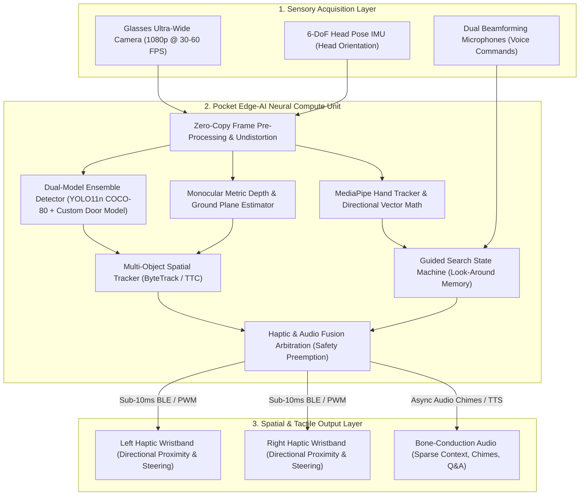
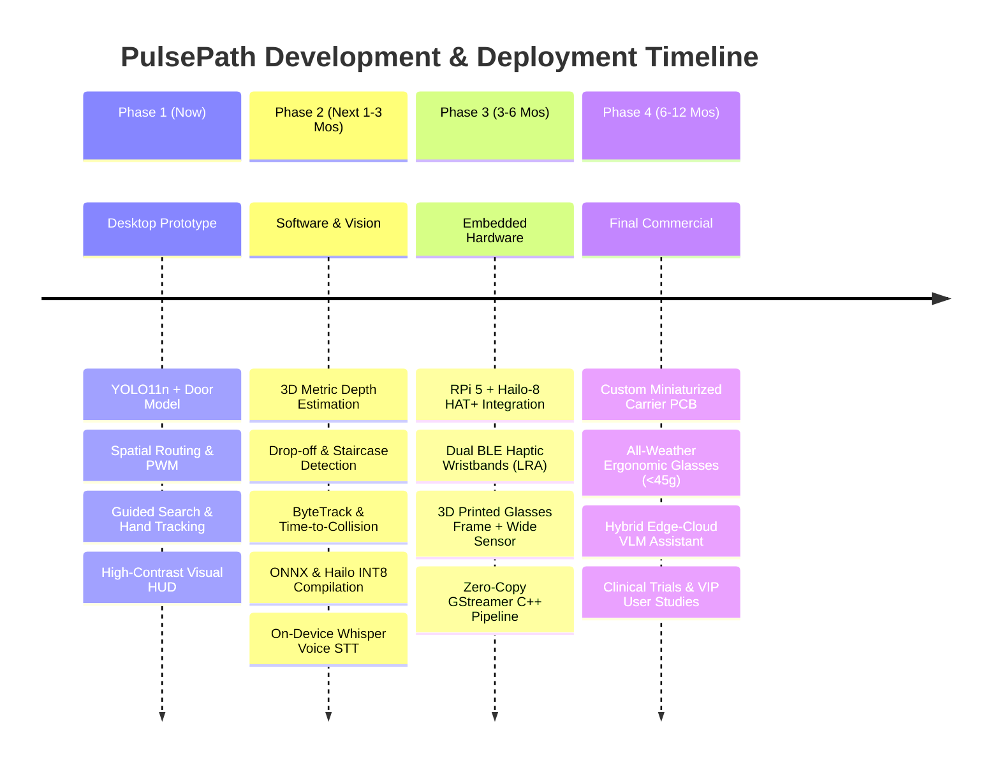

# PulsePath: System Implementation Plan & Final Vision Roadmap
**Project Name:** PulsePath (Nethra Assistive Vision)  
**System Category:** Edge-AI Wearable Computer Vision & Spatial Haptic Navigation for the Visually Impaired  
**Document Version:** 1.0.0  
**Status:** Active Implementation & Production Roadmap  

---

## 1. Executive Summary & Ultimate Final Goal

### 1.1 The Problem
Visually impaired and blind individuals (VIPs) face severe mobility and accessibility barriers in both indoor and outdoor environments. Existing assistive solutions suffer from critical flaws:
* **White Canes & Guide Dogs**: Only detect immediate physical contact or ground-level obstacles; cannot detect head-level hazards (overhanging tree branches, low pipes, open cabinet doors), identify distant landmarks, or locate specific items (doors, empty seats, personal items).
* **Audio-Heavy Smart Apps & Glasses**: Traditional smart glasses flood the user's ears with non-stop synthetic speech announcements. This causes severe cognitive fatigue and, most critically, **blinds the user's natural acoustic perception (echolocation, ambient auditory cues, approaching vehicles, and footfalls)**.
* **Cloud-Dependent Vision Systems**: Relying on cellular connectivity and cloud APIs introduces 1.5–5.0 second latencies and catastrophic failures when offline, making real-time navigation hazardous.

### 1.2 The Ultimate Final Goal
The final goal of **PulsePath** is to create an **ears-free, ultra-low-latency, edge-AI wearable navigation ecosystem** that grants visually impaired individuals total spatial independence and situational awareness. 

The end-state commercial system consists of three seamlessly integrated hardware components:
1. **Ultra-Lightweight Smart Glasses (< 45 grams)**:
   - Houses an ultra-wide (120°–160° FoV) camera, an ambient light sensor, a 6-axis IMU (gyroscope + accelerometer for head tracking), dual beamforming MEMS microphones, and bone-conduction transducers.
   - Completely free of heavy batteries or hot processors on the head to maximize all-day comfort.
2. **Pocket Neural Compute Unit (Belt / Pocket-worn)**:
   - A compact, power-bank-sized embedded edge-AI computer (e.g., Raspberry Pi 5 with a 26 TOPS Hailo-8 / Hailo-10H NPU or custom Apple/Qualcomm mobile NPU).
   - Runs local real-time object detection (30+ FPS), 3D metric depth estimation, negative hazard (drop-off / curb / staircase) detection, and on-device Small Language Models (SLMs) completely offline.
3. **Dual Spatial Haptic Wristbands (Left & Right)**:
   - Wireless wristbands powered by Linear Resonant Actuator (LRA) or Voice Coil Actuator (VCA) haptic motors.
   - Translates environmental geometry directly into intuitive tactile language:
     - **Obstacle Proximity & Direction**: Frequency- and amplitude-modulated tactile waves (simulated PWM duty cycles) alert the left, center, or right sectors of the body.
     - **Interactive Hand Steering**: Directs the user's hand toward desired targets (e.g., door handles, bottles, crosswalk buttons) with sub-degree tactile centering pulses ("da-DUM" heartbeat confirmation).
     - **Safety Preemption**: Immediate high-frequency overrides preempt any guidance if an imminent hazard enters the immediate walking trajectory.

---

## 2. Architecture & Design Principles



### Core Design Pillars:
* **Ears-Free by Default**: Haptics handle 95% of spatial awareness (distance, steering, obstacles). Audio is strictly reserved for confirmation chimes, sparse contextual milestones, and user-initiated conversational inquiries.
* **Hard Real-Time Latency (< 30ms Glass-to-Wrist)**: Safety in walking requires total sensor-to-haptic latency under 30ms to prevent collisions at normal walking speed (1.2–1.4 m/s).
* **Deterministic Safety Overrides**: Guidance or search cues are immediately silenced if a moving or static collision hazard enters the walking zone at $\ge 80\%$ threat proximity.
* **Offline Sovereignty**: Zero cloud dependencies for obstacle avoidance, guidance, and basic scene context. Functions in remote areas, subways, basements, or during network blackouts.

---

## 3. Current Implementation Status ("NOW" - Phase 1)

The system currently runs as a fully functional, high-performance Desktop Prototype with real-time video feeds, hardware acceleration on Apple Silicon (M-series GPU/NE via Metal Performance Shaders), hand steering, and simulated tactile telemetry.

| Component / Subsystem | Current Implementation | Module / File Reference | Status |
| :--- | :--- | :--- | :---: |
| **Vision Ingestion** | iPhone Ultra-Wide (0.5x Continuity Camera) + Mac FaceTime HD + Synthetic Mock Feed | [`pulsepath/camera.py`](file:///Users/mahendulnith/Project/Assistive_Vision_Prototype/pulsepath/camera.py) | **Completed** |
| **Ensemble Detection** | Dual-Model YOLO11 Nano (COCO-80) + Fine-Tuned `pulsepath_doors_yolo11n.pt` with IoU NMS deduplication | [`pulsepath/detection.py`](file:///Users/mahendulnith/Project/Assistive_Vision_Prototype/pulsepath/detection.py) | **Completed** |
| **Model Fine-Tuning** | Automated training pipeline using Apple M4 MPS GPU for indoor door recognition | [`train.py`](file:///Users/mahendulnith/Project/Assistive_Vision_Prototype/train.py) | **Completed** |
| **Spatial Routing** | 3-Zone horizontal partitioning (Left / Center / Right) & bounding-box area-to-PWM scaling | [`pulsepath/detection.py`](file:///Users/mahendulnith/Project/Assistive_Vision_Prototype/pulsepath/detection.py) | **Completed** |
| **Guided Search** | 4-State machine (`IDLE`, `SCANNING`, `TRACKING`, `CONFIRMED`) with look-around memory | [`pulsepath/guidance.py`](file:///Users/mahendulnith/Project/Assistive_Vision_Prototype/pulsepath/guidance.py) | **Completed** |
| **Hand Tracking** | MediaPipe Tasks `HandLandmarker` index-finger tracking & alignment math ($\pm 8\%$ tolerance) | [`pulsepath/hand_tracker.py`](file:///Users/mahendulnith/Project/Assistive_Vision_Prototype/pulsepath/hand_tracker.py) | **Completed** |
| **Haptic Pattern Engine** | Distance-modulated pulse frequency (2–8 Hz), "da-DUM" heartbeat pattern, and $\ge 80\%$ safety override | [`pulsepath/haptics.py`](file:///Users/mahendulnith/Project/Assistive_Vision_Prototype/pulsepath/haptics.py) | **Completed** |
| **Visual HUD & Telemetry** | High-contrast visual wristband widgets, PWM indicators ($0-100\%$), threat glow, vector arrows | [`pulsepath/hud.py`](file:///Users/mahendulnith/Project/Assistive_Vision_Prototype/pulsepath/hud.py) | **Completed** |
| **Audio Engine** | Async background TTS (`say`) + System confirmation chimes (`afplay`) | [`pulsepath/audio.py`](file:///Users/mahendulnith/Project/Assistive_Vision_Prototype/pulsepath/audio.py) | **Completed** |
| **Scene Context** | Morning bed wake-up routine detection + "Where am I?" campus/location query | [`pulsepath/context.py`](file:///Users/mahendulnith/Project/Assistive_Vision_Prototype/pulsepath/context.py) | **Completed** |
| **Automated Testing** | 13 Unit tests covering state machine transitions, tolerances, pulse generation, and safety preemption | [`tests/`](file:///Users/mahendulnith/Project/Assistive_Vision_Prototype/tests/) | **Completed** |

---

## 4. Gap Analysis: Moving from Prototype to Final Product

To transition from the current desktop prototype to an all-day wearable assistive device, the following technical and hardware transitions are required:

```
[ Current Desktop Prototype ]                     [ Target Wearable Production System ]
• 2D Bounding Box Area Heuristics       ───►      • True 3D Metric Depth (Meters) & Ground Plane
• Single-Frame Detections               ───►      • Temporal Multi-Object Tracking & Time-to-Collision
• Keyboard Key Triggers (F/B/P)         ───►      • Always-on Keyword Spotting & Natural Voice Dialog
• Visual HUD Simulating Wristbands      ───►      • Physical Dual BLE LRA/VCA Haptic Wristbands
• Mac M4 Laptop Host                    ───►      • Pocket Edge-AI Compute Unit (Hailo-8 / NPU)
• iPhone Continuity Camera              ───►      • Lightweight 1080p Ultra-Wide Smart Glasses Frame
• Fixed Context Statements              ───►      • On-Device Small Multimodal Model (SLM/VLM)
```

---

## 5. Comprehensive Phased Implementation Roadmap



---

### Phase 2: Software & 3D Spatial Enhancements (Months 1–3)
**Objective:** Transform 2D image analysis into true 3D spatial geometry and replace simulated inputs with hands-free voice interaction.

#### 1. 3D Metric Depth Estimation & Ground Plane Analysis
* **Monocular Metric Depth Integration**:
  - Deploy lightweight metric depth models (e.g., **Depth Anything v2 Small / FastDepth / MiDaS-v3**) optimized for real-time edge inference.
  - Convert pixel coordinates $(u, v)$ and depth $Z$ into calibrated 3D camera space coordinates $(X, Y, Z)$ in meters.
  - Replace area ratio heuristics with direct metric distance (e.g., alert triggers at $3.0\text{ m} \to 2.0\text{ m} \to 1.0\text{ m}$).
* **Ground Hazard & Negative Obstacle Detection**:
  - Implement RANSAC floor-plane segmentation.
  - Detect downward drop-offs, subway platform edges, open holes, and descending stairs that 2D object detectors cannot see.
  - Overhanging hazard detection (e.g., branches or signs at head level between $1.5\text{ m} - 2.0\text{ m}$ height).

#### 2. Temporal Tracking & Dynamic Time-to-Collision (TTC)
* **Multi-Object Tracking (MOT)**:
  - Integrate **ByteTrack** or **BoT-SORT** to track objects across video frames.
  - Maintain unique IDs for obstacles to filter out transient false alarms and stabilize guidance vectors.
* **Predictive Collision Modeling**:
  - Calculate velocity vectors ($\vec{v}$) and Time-to-Collision ($\text{TTC} = \frac{d}{\|\vec{v}\|}$) for dynamic obstacles (e.g., pedestrians, approaching cyclists, reversing cars).
  - Escalate haptic urgency if TTC falls below $1.8\text{ seconds}$, regardless of absolute distance.

#### 3. Hands-Free Voice Command & Speech-to-Intent Pipeline
* **Local Offline Wake-Word & STT**:
  - Integrate an ultra-low-power offline wake-word engine (e.g., **openWakeWord** or **Porcupine**) listening for *"Hey PulsePath"*.
  - Deploy quantized on-device STT (**Whisper.tflite** / **Sherpa-ONNX** / **Vosk**) to process natural voice commands:
    - *"Find an empty chair."*
    - *"Guide me to the exit door."*
    - *"Where can I cross the street?"*
    - *"Read the door number."*

#### 4. Model Edge Quantization & Export
* **Cross-Platform Compilation**:
  - Export PyTorch models to **ONNX**, **CoreML (FP16/INT8)**, and **LiteRT / TFLite (INT8)**.
  - Validate inference on the **Hailo Dataflow Compiler (DFC)** to generate `.hef` binaries ready for hardware acceleration.

---

### Phase 3: Wearable Hardware Prototyping (Months 3–6)
**Objective:** Transition off the laptop to the untethered pocket compute unit, physical smart glasses, and wireless haptic wristbands.

#### 1. Physical Dual-Wristband Haptics (Hardware Build)
* **Microcontroller & Actuators**:
  - Dual custom wristbands using **ESP32-C3** or **Nordic nRF52840** BLE microcontrollers.
  - Linear Resonant Actuators (LRA) driven by **TI DRV2605L** haptic drivers.
  - Capable of sharp, crisp transient clicks, continuous PWM frequency sweeps (50 Hz to 250 Hz), and multi-level tactile patterns without mechanical lag.
* **Communication Protocol**:
  - Custom low-latency BLE 5.3 or ESP-NOW peer-to-peer RF protocol.
  - Guaranteed packet delivery with round-trip latency $< 8\text{ ms}$.

#### 2. Pocket Compute Unit Assembly
* **Compute Hardware**:
  - **Raspberry Pi 5 (8GB)** paired with the official **Hailo-8 AI HAT+ (26 TOPS)** or **Hailo-10H**.
  - Runs a stripped-down Linux operating system (Ubuntu Core / Yocto Linux) booting in $< 8\text{ seconds}$.
* **Power & Thermal Management**:
  - 10,000 mAh USB-PD (Power Delivery) lithium-polymer battery unit delivering 6–8 hours of continuous operation.
  - Low-noise active heat-pipe dissipation keeping enclosure surface temperatures below $38^\circ\text{C}$.

#### 3. Smart Glasses Prototype (V1 Alpha)
* **Optics & Mechanics**:
  - 3D printed lightweight nylon (SLS) frame weighing under $45\text{ grams}$.
  - Wide-angle (130° FoV) global shutter camera module connected via lightweight Kevlar-reinforced MIPI-CSI or USB-C tether to the pocket unit.
  - Integrated bone-conduction transducers built into the spectacle temples (over the mastoid bone).
  - 6-DoF Bosch BNO085 IMU embedded in the frame to compensate for user head tilt and saccadic gaze shifts.

#### 4. Embedded Pipeline Orchestration
* **C++ / Rust Zero-Copy Runtime**:
  - Port core pipelines to C++20 or Rust using GStreamer and the HailoRT C++ API.
  - Zero-copy buffer sharing between camera capture, Hailo NPU inference, and BLE haptic dispatch.
  - Stable 30 FPS inference with $< 22\text{ ms}$ glass-to-wrist total latency.

---

### Phase 4: Final Product & Commercial Ecosystem (Months 6–12)
**Objective:** Miniaturization, clinical validation, regulatory approval, and ecosystem readiness.

#### 1. Custom PCB & Industrial Miniaturization
* **All-in-One Compute Board**:
  - Replace development SBCs with a custom carrier board featuring an integrated System-on-Module (SoM) and NPU accelerator.
  - Dimensions: Similar to a slim credit-card power bank ($100 \times 60 \times 14\text{ mm}$).
* **Commercial Smart Glasses (V2 Final)**:
  - Injection-molded titanium/magnesium alloy frame.
  - Weatherproof (IP65 rated for rain and dust resistance).
  - Prescription lens compatibility or high-contrast tinted photochromic lenses.

#### 2. Hybrid Edge-Cloud Cognitive Intelligence
* **On-Device Small Language Model (SLM)**:
  - Run quantized vision-language models (e.g., **MobileVLM V2 1.7B**, **PaliGemma INT4**, or **Llama-3.2-1B-Vision**) on the pocket NPU for complex offline scene descriptions.
* **On-Demand 5G Cloud Fallback**:
  - Optional cloud link triggered only when the user explicitly requests high-detail inspection:
    - *"Read the fine print on this medicine box."*
    - *"What denomination is this currency bill in my hand?"*
    - *"Describe the painting in front of me."*

#### 3. Clinical Trials & Accessibility Certification
* **User Studies & Co-Design**:
  - Partner with local and global blind federations (e.g., National Federation of the Blind, RNIB, Sri Lanka Council for the Blind).
  - Iterative testing across varying degrees of visual impairment (congenital blindness, retinitis pigmentosa, macular degeneration, low vision).
* **Compliance & Safety Standards**:
  - Certification under **FDA Class I Medical Device / CE Medical Device Regulation (MDR)** for assistive mobility aids.
  - FCC / CE EMC compliance for wearable RF and battery thermal safety.

---

## 6. Target Technical Specifications (Final Product)

| Specification Parameter | Prototype (Phase 1 - Today) | Production System (Final Goal) |
| :--- | :--- | :--- |
| **System Form Factor** | Mac Laptop + iPhone Camera + Screen HUD | Smart Glasses (<45g) + Pocket Unit + Dual Wristbands |
| **Detection Speed (FPS)** | 25–30 FPS on Apple Silicon MPS | 30–60 FPS on Hailo-8 / Dedicated Edge NPU |
| **End-to-End Latency** | ~35–50 ms (Video to Screen HUD) | **$\le 20\text{ ms}$ (Camera $\to$ Haptic Pulse)** |
| **Depth Perception** | 2D Bounding Box Area % Heuristic | **True Metric Depth ($0.3\text{m} - 8.0\text{m} \pm 5\%$)** |
| **Hazard Coverage** | 80 COCO Classes + Custom Doors | **COCO-80 + Doors + Curbs + Stairs + Head-Level Obstacles** |
| **Target Alignment** | MediaPipe Hand Landmark Index Vector | **Head Pose IMU + 3D Hand Vector + Tactile Beam Steering** |
| **User Output** | Visual HUD PWM + Audio TTS | **Dual LRA Wristbands + Bone-Conduction Chimes** |
| **Battery Life** | Tethered to Laptop Power | **8–10 Hours Active Navigation (USB-PD Quick Charge)** |
| **Weight on Head** | 0g (External Camera on Stand) | **$< 42\text{ grams}$** |
| **Connectivity Requirement** | Completely Offline | **100% Offline Core Safety + Optional 5G Cloud Detail** |

---

## 7. Immediate Next Steps & Action Items

To maintain rapid development momentum, the recommended immediate priorities are:
1. **Depth Estimation Module Integration**: Add a monocular metric depth estimator into `pulsepath/detection.py` to output real metric distances (meters) alongside 2D bounding boxes.
2. **Model Export to ONNX & TFLite**: Run automated export of `pulsepath_doors_yolo11n.pt` and `yolo11n.pt` to ONNX and INT8 quantized formats.
3. **BLE Haptic Bridge Simulation**: Implement a serial/BLE telemetry sender in `pulsepath/haptics.py` ready to transmit PWM values to external microcontrollers (ESP32 / Arduino).
4. **Offline Voice Intent Parser**: Replace keyboard key listening with an open-source on-device wake-word and keyword recognition script.
