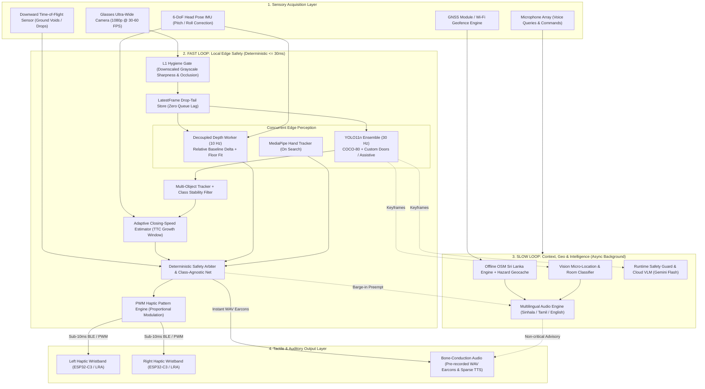
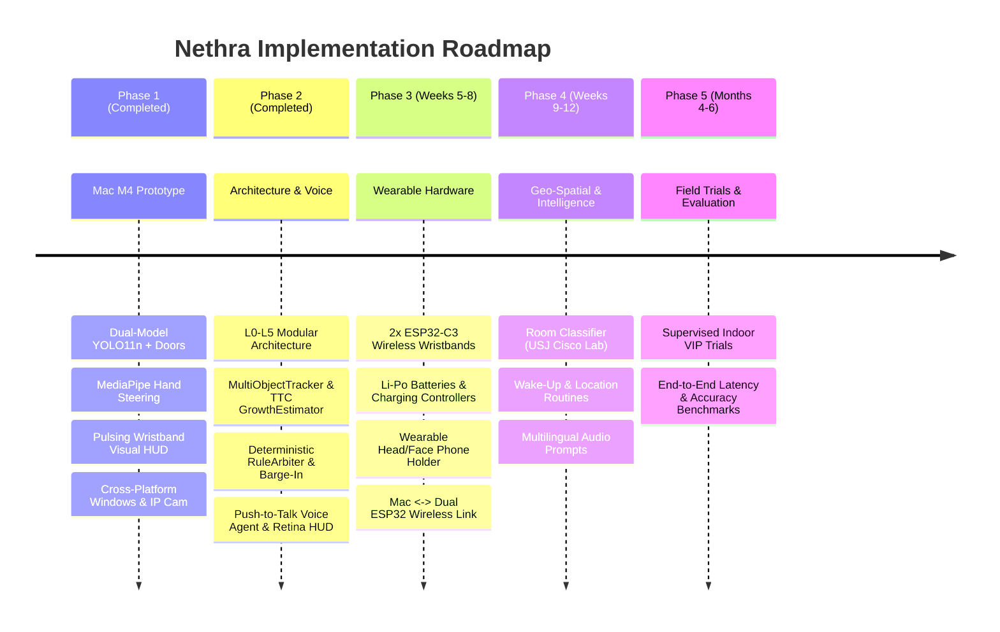

# Nethra: Master Assistive Perception & Future Implementation Plan

> **System Category:** Edge-AI Wearable Computer Vision, Spatial Haptics & Geo-Spatial Perception for the Visually Impaired  
> **Document Version:** 2.0.0 (Unified Master Architecture)  
> **Authors & Roles:**  
> - **Member 1 (Current Project Lead / Mac M4):** Model Training, Selection, Quantization, Edge Object Detection & Core Vision  
> - **Member 2 (Co-Developer / Windows):** Cross-Platform Architecture, Asynchronous Concurrency, Tracking, Safety Arbiter & Cloud/Geo Services  
> - **Member 3 (Hardware & Firmware Lead / Embedded):** Dual ESP32-C3 Wireless Haptic Wristbands (with Li-Po Batteries & Charging Controllers), Wearable Head/Face Smartphone Mount & Mac Wireless Integration  
> **Repository:** `https://github.com/MahenDulnith/Nethra.git`

---

## 1. Executive Summary & Core Philosophy

For visually impaired and blind individuals (VIPs), mobility in complex environments (such as Sri Lankan urban roads, open storm drains, uneven curbs, and indoor corridors) demands sub-second spatial certainty. Existing assistive solutions fail because:
1. **White Canes:** Detect only ground obstacles in immediate physical reach; they cannot detect head-height hazards (overhanging tree limbs, open truck gates) or guide a user to distant targets (doors, empty chairs).
2. **Audio-Heavy Smart Apps:** Non-stop voice announcements induce severe cognitive fatigue and **mask the traveler's natural acoustic perception (ambient traffic, echolocation, and footsteps)**.
3. **Cloud-Dependent Vision Systems:** Latencies of 1.5–5.0 seconds and constant cellular dropouts make real-time collision prevention impossible.

### The Nethra Dual-Loop Solution:
Nethra bridges laboratory edge-AI into a physical wearable using a **Dual-Loop Hybrid Engine**:
* **The Fast Loop (Local Edge Safety — 100% Offline, $\le 30\text{ ms}$ glass-to-wrist, 30 FPS):** Guarantees physical safety, directional clearance, ground drops/stairs, and dual-wristband tactile steering.
* **The Slow Loop (Context, Geo-Spatial & Cloud VLM — Async Background Thread, 1.0–2.5 s):** Delivers rich contextual descriptions, sign/text reading, offline OpenStreetMap hazard memory, and spatial Q&A whenever triggered.



---

## 2. Baseline Status: What Has Been Built (L0–L5 Architecture)

The system runs as a validated, high-performance Desktop Prototype across Apple Silicon (M4 GPU/NE via Metal Performance Shaders) and Windows:

| Component / Subsystem | Current Implementation | Module / File Reference | Status |
| :--- | :--- | :--- | :---: |
| **Vision Ingestion (L1)** | Multi-source: iPhone Continuity Camera (0.5x), Mac FaceTime HD, Windows DirectShow webcam, and mobile IP stream URLs (`http://...`) | [`adapters/camera/`](file:///Users/mahendulnith/Project/Assistive_Vision_Prototype/adapters/camera/) | **Completed** |
| **Ensemble Detection (L2)** | Dual-Model YOLO11n (COCO-80) + Fine-Tuned `models/nethra_doors_yolo11n.pt` with IoU=0.45 NMS & multi-bed disambiguation | [`services/safety/yolo_ensemble.py`](file:///Users/mahendulnith/Project/Assistive_Vision_Prototype/services/safety/yolo_ensemble.py) | **Completed** |
| **Model Fine-Tuning** | Automated training pipeline using Apple M4 MPS GPU on HomeObjects-3K dataset (~9.1ms latency) | [`train.py`](file:///Users/mahendulnith/Project/Assistive_Vision_Prototype/train.py) | **Completed** |
| **Spatial Routing (L2)** | 3-Zone horizontal partitioning (Left / Center / Right) & FOV-scaled area-to-PWM proximity mapping | [`services/safety/spatial_router.py`](file:///Users/mahendulnith/Project/Assistive_Vision_Prototype/services/safety/spatial_router.py) | **Completed** |
| **Guided Search (L4)** | State machine (`SEARCHING` $\to$ `HEAD_GUIDE` $\to$ `HAND_GUIDE` $\rightleftharpoons$ `ALIGNED`) with temporal confirmation & look-around scene memory | [`features/lookaround/guidance.py`](file:///Users/mahendulnith/Project/Assistive_Vision_Prototype/features/lookaround/guidance.py) | **Completed** |
| **Hand Tracking (L2)** | MediaPipe Tasks `HandLandmarker` index-finger tracking & alignment math ($\pm 8\%$ tolerance) | [`services/safety/hand_tracker.py`](file:///Users/mahendulnith/Project/Assistive_Vision_Prototype/services/safety/hand_tracker.py) | **Completed** |
| **Haptic Modulation (L1)** | Error-scaled pulse periods (0.8s $\to$ 0.2s), synchronised double-pulse `"da-DUM"`, and $\ge 80\%$ safety override | [`adapters/haptic/pattern_engine.py`](file:///Users/mahendulnith/Project/Assistive_Vision_Prototype/adapters/haptic/pattern_engine.py) | **Completed** |
| **Visual HUD & Telemetry (L5)** | High-contrast wristband strap gauges with real-time PWM fill ($0-100\%$), reticles, and vector arrows | [`shell/hud/opencv_hud.py`](file:///Users/mahendulnith/Project/Assistive_Vision_Prototype/shell/hud/opencv_hud.py) | **Completed** |
| **Audio Engine (L3)** | Non-blocking async macOS TTS (`say`) + Windows SAPI5 (`System.Speech`) + macOS chimes (`afplay`) + Windows `winsound` | [`services/voice/offline_tts.py`](file:///Users/mahendulnith/Project/Assistive_Vision_Prototype/services/voice/offline_tts.py) | **Completed** |
| **Automated Testing** | 58 Unit & architectural parity tests covering L0–L5 dependency graph, state machine transitions, and safety preemption | [`tests/`](file:///Users/mahendulnith/Project/Assistive_Vision_Prototype/tests/) | **Completed** |

---

## 3. Mathematical & Algorithmic Upgrades

### 3.1 Time-to-Collision (TTC) & Closing-Speed Mathematics
* **Closing Speed:** Box expansion ($dh/dt$) measures **relative approach speed**, not isolated obstacle motion.
* **Adaptive Sampling Window:**
  - High growth rate ($> 15\% \text{ per frame}$): Short window (8–12 frames) for fast-approaching vehicles/bicycles.
  - Low growth rate ($< 5\% \text{ per frame}$): Standard window (24–30 frames) for stable pedestrian approach.
* **Escalation Rule:** If $\text{TTC} \le 1.8\text{ seconds}$, haptic urgency escalates to 100% PWM regardless of absolute distance.

### 3.2 Relative Depth Normalization & Ground Drop-Off Detection
* **Running Baseline Normalization:** Maintain an Exponential Moving Average (EMA) of floor-strip depth values during normal locomotion:
  $$\text{EMA}_t = \alpha \cdot \text{Depth}_{\text{floor}, t} + (1 - \alpha) \cdot \text{EMA}_{t-1}$$
* **Negative Obstacle Delta:** An open drain or descending staircase registers as an abrupt negative depth drop ($\Delta \text{Depth} > \text{Threshold}$), immediately triggering the `drop_warning.wav` earcon.

### 3.3 Class-Agnostic Safety Net
* If the depth worker detects a physical obstruction inside the walking corridor:
  - If YOLO identifies the object $\to$ Spoken label: *"Chair at 12 o'clock."*
  - If YOLO fails to classify $\to$ Spoken label: *"Obstacle ahead."*
* **Core Rule: The absence of a classification must NEVER lead to silence.**

### 3.4 "I Cannot See" Fail-Safe Mode
* If the L1 Hygiene Gate flags consecutive frames for $> 0.5\text{ seconds}$ (lens covered, blur, darkness, or disconnected camera):
  - Trigger a distinctive continuous double-pulse on both wristbands.
  - Spoken audio announces: *"Camera obscured. Walking assistance paused."*
* **Core Rule: Absence of vibration must always signify a clear path, never a frozen or dead system.**

---

## 4. 3-Developer Role & Responsibility Matrix

To achieve maximum engineering throughput without hardware bottlenecks, the project is strictly divided according to platform strengths:

```
+---------------------------------------------------------------------------------------------------+
|                                  3-DEVELOPER RESPONSIBILITY MATRIX                                 |
+---------------------------------------------------------------------------------------------------+
|  MEMBER 1 (Mac / Apple Silicon M4)        MEMBER 2 (Windows / Concurrency)     MEMBER 3 (Embedded / HW)
|  - Lead Architect & Vision Lead           - Systems, Safety & Simulation Lead  - Hardware & Firmware Lead
|  -----------------------------------      ---------------------------------    --------------------------
|  • Model Selection & Architecture         • L0-L5 Architecture & Camera HAL    • Dual ESP32-C3 Wristbands
|  • Training & Fine-Tuning Pipeline        • LatestFrame Threaded Grabber       • Li-Po Battery & Charge Ctrl
|  • Apple Silicon MPS Acceleration         • Frame Hygiene & RuleArbiter        • Haptic Actuators & Drivers
|  • Multi-Bed Disambiguation & NMS         • MultiObjectTracker & TTC Growth    • Head/Face Phone Mount Build
|  • Hand Tracking & Steering Math          • Clock-Face Speech & Barge-In       • Mac <-> 2x ESP32 Wireless
|  • Push-to-Talk Voice Agent               • Honest Latency Probe & Benchmarks  • 200ms Heartbeat Watchdog
|  • Final Evaluation & Metrics             • Offline OpenStreetMap Engine       • Glass-to-Wrist Latency Rig
|  • Panel Demo Presentation Lead           • VLM Runtime Safety Guards          • Battery & Thermal Mgt.
+---------------------------------------------------------------------------------------------------+
```

### Detailed Division of Work:

#### Member 1 (Mac — Apple Silicon M4):
1. **Model Selection & Architecture:** Benchmark YOLO11 Nano + custom fine-tuned indoor navigation models (`nethra_doors_yolo11n.pt`).
2. **Model Training & Fine-Tuning:** Maintain `train.py` using M4 GPU Metal Performance Shaders (`device="mps"`). Fine-tune models on indoor & Sri Lankan hazard datasets (HomeObjects-3K, custom doors, obstacles).
3. **Voice Agent & High-DPI HUD:** Maintain the Push-to-Talk Voice Agent (`services/agent/voice_agent.py`), 80-class natural-language intent parser, and Retina 2x TrueType HUD (`shell/hud/opencv_hud.py`).
4. **Hand Tracking Engine:** Maintain and optimize MediaPipe Tasks Hand Landmarker for tactile guidance.
5. **Demonstration & Cisco Lab Showcase:** Lead the live evaluation demo at the University of Sri Jayewardenepura Cisco Networking Lab.

#### Member 2 (Windows / Systems & Concurrency Lead):
1. **Asynchronous Multi-Worker Refactor:** Restructure camera ingestion with `ThreadedFrameGrabber` drop-tail buffering and decoupled perception workers.
2. **Tracking, Hygiene & Closing Speed:** Maintain `MultiObjectTracker` with class stability filtering, L2 Frame Hygiene (`blur_scorer`, `luminance_checker`, `occlusion_heuristic`), and the TTC `GrowthEstimator` in `services/safety/`.
3. **Deterministic Safety Arbiter & Speech Policy:** Maintain `RuleArbiter`, priority matrix, cooldown suppression, and hard barge-in speech preemption.
4. **Latency Probe & Benchmark Suite:** Maintain `harness/bench/` and `ci/dependency_graph_check.py` to enforce architectural invariants.
5. **Geo-Spatial & Cloud VLM Layer:** Implement offline OpenStreetMap hazard caching in SQLite and build the asynchronous Gemini Flash client with `vlm_runtime_guard`.

#### Member 3 (Embedded Systems & Hardware Lead):
1. **Dual Wireless Haptic Wristbands (2× ESP32-C3):** Assemble left and right wristbands using two **ESP32-C3** microcontrollers, **3.7V rechargeable Li-Po batteries**, **TP4056 USB-C charging controller modules**, and haptic vibration actuators/drivers.
2. **Wearable Smart Glasses / Face Phone Holder:** Fabricate the head/face-mounted smartphone holder so the user can wear the phone comfortably at eye level and stream live first-person camera video to the Mac.
3. **Mac-to-Dual-ESP32 Wireless Integration:** Connect both ESP32-C3 wristbands wirelessly (BLE / Wi-Fi) to the host Mac so left and right PWM and pattern commands actuate both wristbands in real time.
4. **Watchdog Heartbeat & Safety Cap:** Implement the 200 ms wireless heartbeat, battery ADC monitoring, and 85% firmware intensity comfort cap in `firmware/wristband-esp32/wristband-esp32.ino`.
5. **Hardware Latency Verification:** Verify end-to-end camera-to-Mac-to-wristband actuation latency and battery runtime.

---

## 5. Phased Implementation Roadmap & Concrete Exit Gates



---

### Phase 2: Concurrency, Tracking, Voice Agent & Deterministic Safety Arbiter (Weeks 1–4)
* **Lead:** Member 2 (Windows) & Member 1 (Mac)
* **Deliverables:**
  1. Threaded pipeline: `ThreadedFrameGrabber` drop-tail slot preventing frame queue lag.
  2. L2 Frame Hygiene (`blur_scorer`, `luminance_checker`, `occlusion_heuristic`).
  3. `MultiObjectTracker` with class stability filtering and `GrowthEstimator` TTC urgency escalation.
  4. Deterministic `RuleArbiter`, `SpeechDispatcher` with forbidden-phrase blocking, and Push-to-Talk `VoiceAgent`.
* **Exit Gate:** Sustained 30 FPS YOLO ensemble; 0 architectural violations in `ci/dependency_graph_check.py`; all 63 unit tests passing.

### Phase 3: Dual ESP32-C3 Haptic Wristbands & Wearable Face Phone Mount (Weeks 5–8)
* **Lead:** Member 3 (Hardware) | **Support:** Member 1 (Mac Integration) & Member 2 (Wireless Client)
* **Deliverables:**
  1. Two self-contained wireless wristbands built with **2× ESP32-C3**, **3.7V Li-Po batteries**, **TP4056 USB-C charging controllers**, and vibration motors/drivers.
  2. Custom **wearable head/face smartphone holder (glasses mount)** streaming live first-person camera video to the Mac.
  3. Wireless Mac-to-dual-ESP32-C3 communication driving left and right wrist vibrations in real time with a 200 ms watchdog heartbeat.
* **Exit Gate:** 60-minute continuous wireless soak test without disconnect; responsive left/right tactile actuation from live phone camera feed.

### Phase 4: Geo-Spatial Intelligence & Room Classifier (Weeks 9–12)
* **Lead:** Member 1 (Mac / Room Vision) & Member 2 (Geo / Cloud)
* **Deliverables:**
  1. Multi-modal location engine: Macro-location (OSM Sri Lanka / GPS) + Micro-location (Indoor Vision Room Classifier).
  2. Pre-configured USJ Cisco Networking Lab and Malabe home geofences.
  3. Multilingual Sinhala, Tamil, and English audio dispatcher with zero-latency pre-recorded WAV earcons.
  4. Cloud VLM client with `vlm_runtime_guard` forbidding hallucinated phrases (*"safe to cross"*, *"all clear"*).
* **Exit Gate:** 100% accurate room classification during Cisco Lab walkthrough; 0 ms jitter on Fast Loop during cloud disconnects.

### Phase 5: Supervised VIP User Studies & Outdoor Hardening (Months 4–6)
* **Lead:** Entire Team | **Partners:** Sri Lanka Council for the Blind / USJ Research Group
* **Deliverables:**
  1. Supervised indoor navigation trials with 3–5 visually impaired participants.
  2. Outdoor pedestrian route evaluations (Galle Road / Malabe junction) paired with traditional white cane.
  3. Evaluation metrics: Hazard recall rate, false positive alert frequency, NASA-TLX cognitive workload index.
* **Exit Gate:** Hazard recall $\ge 92\%$; user comprehension of haptic patterns $\ge 95\%$.

---

## 6. Git Branching & Collaborative Workflow

To prevent code divergence across Mac, Windows, and Raspberry Pi environments, the repository follows a strict multi-branch strategy:

```
        main  [Production-Ready Tested Releases]
          ▲
          │  (Merge via Pull Request after CI & Test Pass)
          ├─────────────────────────────────────────────┐
          │                                             │
    feature/mac-perception (Member 1)           feature/async-pipeline (Member 2)
    • Model Training & Fine-Tuning              • L0-L5 Architecture & Camera HAL
    • Apple Silicon MPS Benchmarks              • Frame Hygiene & RuleArbiter
    • MediaPipe Hand Steering                   • MultiObjectTracker & TTC Growth
    • Room Classifier & Bed Disambiguation      • Latency Probe & Benchmark Suite
                                                        │
                                                        ▼
                                                feature/embedded-hw (Member 3)
                                                • RPi 5 + Hailo-8L Setup (.hef)
                                                • ESP32-C3 BLE Firmware
                                                • ToF / IMU Sensor Fusion
```

### Branch Rules:
1. **`main`**: Must always pass all unit tests (`python -m unittest discover -s tests`) on both Mac and Windows.
2. **`feature/mac-perception`**: Owned by Member 1 for model training, dataset scripts, and Apple Silicon optimization.
3. **`feature/async-pipeline`**: Owned by Member 2 for L0–L5 safety services, camera adapters, and benchmark harnesses.
4. **`feature/embedded-hw`**: Owned by Member 3 for embedded Linux, Hailo compilation, and ESP32 C++ firmware.
5. **No Direct Pushes to `main` without Verification**: All PRs require validation on both Mac and Windows before merging.

---

## 7. Immediate 14-Day Action Checklist

- [x] **Day 1–2 (Completed):** Implement Guided Search Mode, MediaPipe index tracking, HUD pulsing wristbands, and pass all unit tests.
- [x] **Day 3 (Completed):** Push native Windows support (DirectShow webcam, SAPI5 TTS, winsound chimes, and IP camera URLs).
- [x] **Day 4–7 (Completed):** Migrate repository to L0–L5 Python architecture with `ThreadedFrameGrabber`, `SafetyEngine`, `MultiObjectTracker`, `GrowthEstimator`, and `RuleArbiter`.
- [x] **Day 8–9 (Completed):** Implement the Room Classifier in `features/context_routines/context_tracker.py` (detecting Computer Lab, Bedroom, Living Room, Kitchen), multi-bed disambiguation in `services/safety/yolo_ensemble.py`, and configure the USJ Cisco Lab geofence.
- [ ] **Day 10–11 (Member 3):** Flash ESP32-C3 with initial BLE GATT PWM receiver firmware and verify 200 ms heartbeat watchdog.
- [ ] **Day 12–13 (Entire Team):** Rehearse the live USJ Cisco Lab presentation script (Location query $\to$ Room identification $\to$ Guided search for door $\to$ Hand alignment $\to$ Obstacle preemption).
- [ ] **Day 14 (Milestone Gate 1):** Full end-to-end rehearsal on both Mac and Windows; merge verified PRs into `main`.
