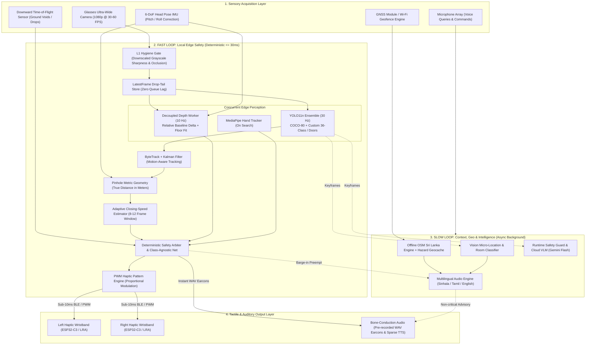
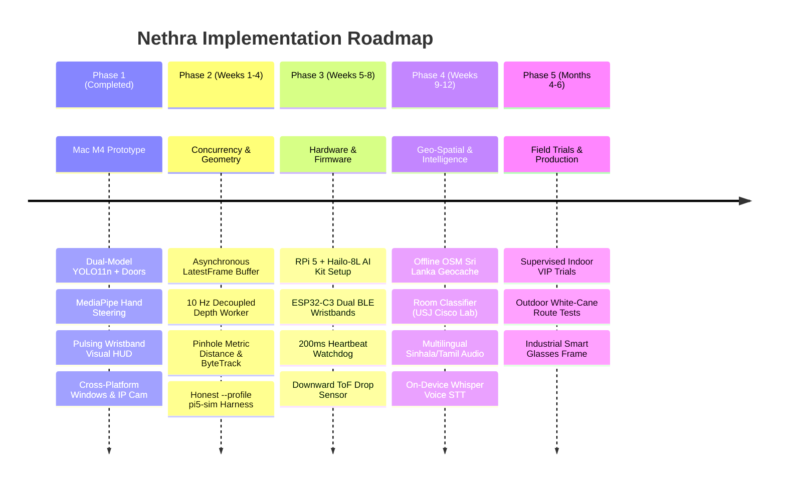

# Nethra: Master Assistive Perception & Future Implementation Plan

> **System Category:** Edge-AI Wearable Computer Vision, Spatial Haptics & Geo-Spatial Perception for the Visually Impaired  
> **Document Version:** 2.0.0 (Unified Master Architecture)  
> **Authors & Roles:**  
> - **Member 1 (Current Project Lead / Mac M4):** Model Training, Selection, Quantization, Edge Object Detection & Core Vision  
> - **Member 2 (Co-Developer / Windows):** Cross-Platform Architecture, Asynchronous Concurrency, Pinhole Metric Geometry, Tracking & Cloud/Geo Services  
> - **Member 3 (Hardware & Firmware Lead / Embedded):** Raspberry Pi 5 + Hailo-8L NPU, ESP32-C3 Dual BLE Wristbands & Physical Sensors  
> **Repository:** `https://github.com/MahenDulnith/Nethra.git`

---

## 1. Executive Summary & Core Philosophy

For visually impaired and blind individuals (VIPs), mobility in complex environments (such as Sri Lankan urban roads, open storm drains, uneven curbs, and indoor corridors) demands sub-second spatial certainty. Existing assistive solutions fail because:
1. **White Canes:** Detect only ground obstacles in immediate physical reach; they cannot detect head-height hazards (overhanging tree limbs, open truck gates) or guide a user to distant targets (doors, empty chairs).
2. **Audio-Heavy Smart Apps:** Non-stop voice announcements induce severe cognitive fatigue and **mask the traveler's natural acoustic perception (ambient traffic, echolocation, and footsteps)**.
3. **Cloud-Dependent Vision Systems:** Latencies of 1.5–5.0 seconds and constant cellular dropouts make real-time collision prevention impossible.

### The Nethra Dual-Loop Solution:
Nethra bridges laboratory edge-AI into a physical wearable using a **Dual-Loop Hybrid Engine**:
* **The Fast Loop (Local Edge Safety — 100% Offline, $\le 30\text{ ms}$ glass-to-wrist, 30 FPS):** Guarantees physical safety, directional clearance, metric depth, ground drops/stairs, and dual-wristband tactile steering.
* **The Slow Loop (Context, Geo-Spatial & Cloud VLM — Async Background Thread, 1.0–2.5 s):** Delivers rich contextual descriptions, sign/text reading, offline OpenStreetMap hazard memory, and spatial Q&A whenever triggered.



---

## 2. Baseline Status: What Has Been Built (L0–L5 Architecture)

The system runs as a validated, high-performance Desktop Prototype across Apple Silicon (M4 GPU/NE via Metal Performance Shaders) and Windows:

| Component / Subsystem | Current Implementation | Module / File Reference | Status |
| :--- | :--- | :--- | :---: |
| **Vision Ingestion (L1)** | Multi-source: iPhone Continuity Camera (0.5x), Mac FaceTime HD, Windows DirectShow webcam, and mobile IP stream URLs (`http://...`) | [`adapters/camera/`](file:///Users/mahendulnith/Project/Assistive_Vision_Prototype/adapters/camera/) | **Completed** |
| **Ensemble Detection (L2)** | Dual-Model YOLO11n (COCO-80) + Fine-Tuned `models/nethra_doors_yolo11n.pt` with IoU=0.45 NMS & multi-bed disambiguation | [`services/safety/yolo_ensemble.py`](file:///Users/mahendulnith/Project/Assistive_Vision_Prototype/services/safety/yolo_ensemble.py) | **Completed** |
| **Model Fine-Tuning** | Automated training pipeline using Apple M4 MPS GPU on HomeObjects-3K dataset (~9.1ms latency) | [`train.py`](file:///Users/mahendulnith/Project/Assistive_Vision_Prototype/train.py) | **Completed** |
| **Spatial Routing (L2)** | 3-Zone horizontal partitioning (Left / Center / Right) & area-to-PWM proximity mapping | [`services/safety/spatial_router.py`](file:///Users/mahendulnith/Project/Assistive_Vision_Prototype/services/safety/spatial_router.py) | **Completed** |
| **Guided Search (L4)** | State machine (`SEARCHING` $\to$ `HEAD_GUIDE` $\to$ `HAND_GUIDE` $\rightleftharpoons$ `ALIGNED`) with temporal confirmation & look-around scene memory | [`features/lookaround/guidance.py`](file:///Users/mahendulnith/Project/Assistive_Vision_Prototype/features/lookaround/guidance.py) | **Completed** |
| **Hand Tracking (L2)** | MediaPipe Tasks `HandLandmarker` index-finger tracking & alignment math ($\pm 8\%$ tolerance) | [`services/safety/hand_tracker.py`](file:///Users/mahendulnith/Project/Assistive_Vision_Prototype/services/safety/hand_tracker.py) | **Completed** |
| **Haptic Modulation (L1)** | Error-scaled pulse periods (0.8s $\to$ 0.2s), synchronised double-pulse `"da-DUM"`, and $\ge 80\%$ safety override | [`adapters/haptic/pattern_engine.py`](file:///Users/mahendulnith/Project/Assistive_Vision_Prototype/adapters/haptic/pattern_engine.py) | **Completed** |
| **Visual HUD & Telemetry (L5)** | High-contrast wristband strap gauges with real-time PWM fill ($0-100\%$), reticles, and vector arrows | [`shell/hud/opencv_hud.py`](file:///Users/mahendulnith/Project/Assistive_Vision_Prototype/shell/hud/opencv_hud.py) | **Completed** |
| **Audio Engine (L3)** | Non-blocking async macOS TTS (`say`) + Windows SAPI5 (`System.Speech`) + macOS chimes (`afplay`) + Windows `winsound` | [`services/voice/offline_tts.py`](file:///Users/mahendulnith/Project/Assistive_Vision_Prototype/services/voice/offline_tts.py) | **Completed** |
| **Automated Testing** | Unit & architectural parity tests covering L0–L5 dependency graph, state machine transitions, and safety preemption | [`tests/`](file:///Users/mahendulnith/Project/Assistive_Vision_Prototype/tests/) | **Completed** |

---

## 3. Mathematical & Algorithmic Upgrades (Incorporating Member 2's Fixes)

### 3.1 Pinhole Camera Geometry for Metric Distance
* **Flaw in Area Heuristics:** A door covers 45% of the frame at 2.5 meters, whereas a cup covers 45% at 20 cm.
* **Metric Formula:**
  $$\text{Distance } Z = \frac{H_{\text{real}} \cdot f_{\text{px}}}{h_{\text{box\_px}}}$$
  Where $f_{\text{px}} = \frac{H_{\text{frame}} / 2}{\tan(\text{VFOV} / 2)}$.
* **Real-World Height Reference Dictionary:**
  ```python
  REAL_HEIGHT_METERS = {
      "person": 1.70, "door": 2.05, "car": 1.50, "bus": 3.20,
      "motorcycle": 1.15, "three_wheeler": 1.75, "chair": 0.85,
      "dining table": 0.75, "bottle": 0.25, "laptop": 0.22,
      "stairs_down": 0.80, "curb": 0.15, "utility_pole": 3.00
  }
  ```
* **Boundary Truncation Safeguard:** If a bounding box touches the frame border ($y_1 \le 2$ or $y_2 \ge H_{\text{frame}} - 2$), mark pinhole distance as truncated and fall back immediately to the depth worker.

### 3.2 Time-to-Collision (TTC) & Closing-Speed Mathematics
* **Closing Speed:** Box expansion ($dh/dt$) measures **relative approach speed**, not isolated obstacle motion.
* **Adaptive Sampling Window:**
  - High growth rate ($> 15\% \text{ per frame}$): Short window (8–12 frames) for fast-approaching vehicles/bicycles.
  - Low growth rate ($< 5\% \text{ per frame}$): Standard window (24–30 frames) for stable pedestrian approach.
* **Escalation Rule:** If $\text{TTC} \le 1.8\text{ seconds}$, haptic urgency escalates to 100% PWM regardless of absolute distance.

### 3.3 Relative Depth Normalization & Ground Drop-Off Detection
* **Running Baseline Normalization:** Maintain an Exponential Moving Average (EMA) of floor-strip depth values during normal locomotion:
  $$\text{EMA}_t = \alpha \cdot \text{Depth}_{\text{floor}, t} + (1 - \alpha) \cdot \text{EMA}_{t-1}$$
* **Negative Obstacle Delta:** An open drain or descending staircase registers as an abrupt negative depth drop ($\Delta \text{Depth} > \text{Threshold}$), immediately triggering the `drop_warning.wav` earcon.

### 3.4 Class-Agnostic Safety Net
* If the depth worker detects a physical obstruction inside the walking corridor ($Z < 2.0\text{ m}$):
  - If YOLO identifies the object $\to$ Spoken label: *"Chair at 12 o'clock, 1.2 meters."*
  - If YOLO fails to classify $\to$ Spoken label: *"Obstacle ahead, 1.2 meters."*
* **Core Rule: The absence of a classification must NEVER lead to silence.**

### 3.5 "I Cannot See" Fail-Safe Mode
* If the L1 Hygiene Gate flags consecutive frames for $> 0.5\text{ seconds}$ (lens covered, blur, darkness, or disconnected camera):
  - Trigger a distinctive continuous double-pulse on both wristbands.
  - Spoken audio announces: *"Camera obscured. Walking assistance paused."*
* **Core Rule: Absence of vibration must always signify a clear path, never a frozen or dead system.**

---

## 4. 3-Developer Role & Responsibility Matrix

To achieve maximum engineering throughput without hardware bottlenecks, the project is strictly divided according to platform strengths:

```
+---------------------------------------------------------------------------------------------------+
|                                  3-DEVELOPER RESPONSIBILITY MATRIX                                 |
+---------------------------------------------------------------------------------------------------+
|  MEMBER 1 (Mac / Apple Silicon M4)        MEMBER 2 (Windows / Concurrency)     MEMBER 3 (Embedded / HW)
|  - Lead Architect & Vision Lead           - Systems, Math & Simulation Lead    - Hardware & Firmware Lead
|  -----------------------------------      ---------------------------------    --------------------------
|  • Model Selection & Architecture         • Threaded Concurrency Refactor      • Raspberry Pi 5 System OS
|  • Training & Fine-Tuning Pipeline        • LatestFrame Drop-Tail Store        • Hailo-8L NPU (.hef) Int.
|  • Apple Silicon MPS Acceleration         • Decoupled 10 Hz Depth Worker       • Dual ESP32-C3 Wristbands
|  • Custom 36-Class Dataset Mining         • Pinhole Geometry & Metric Dist     • LRA Actuators & Drivers
|  • Hand Tracking & Steering Math          • ByteTrack Kalman Integration       • Downward ToF Sensor Fusion
|  • Model Quantization (ONNX/CoreML)       • Honest --profile pi5-sim Harness   • Smart Glasses Frame Build
|  • Final Evaluation & Metrics             • Offline OpenStreetMap Engine       • Glass-to-Wrist Latency Rig
|  • Panel Demo Presentation Lead           • VLM Runtime Safety Guards          • Battery & Thermal Mgt.
+---------------------------------------------------------------------------------------------------+
```

### Detailed Division of Work:

#### Member 1 (Mac — Apple Silicon M4):
1. **Model Selection & Architecture:** Benchmark YOLO11 Nano vs. YOLO11-seg for polygon segmentation on ground voids (`open_drain`, `stairs_down`).
2. **Model Training & Fine-Tuning:** Maintain `train.py` using M4 GPU Metal Performance Shaders (`device="mps"`). Fine-tune models on Sri Lankan hazard datasets (HomeObjects-3K, three-wheelers, custom doors, curbs).
3. **Model Quantization & Export:** Export verified `.pt` weights into **ONNX FP16/INT8**, **CoreML**, and prepare clean ONNX graphs for Member 3's Hailo compilation.
4. **Hand Tracking Engine:** Maintain and optimize MediaPipe Tasks Hand Landmarker for tactile guidance.
5. **Demonstration & Cisco Lab Showcase:** Lead the live evaluation demo at the University of Sri Jayewardenepura Cisco Networking Lab.

#### Member 2 (Windows / Systems & Concurrency Lead):
1. **Asynchronous Multi-Worker Refactor:** Restructure `main.py` into decoupled worker threads (Capture thread $\to$ `LatestFrame` drop-tail slot $\to$ 30 Hz YOLO $\to$ 10 Hz Depth Worker).
2. **Pinhole Metric Geometry:** Implement `REAL_HEIGHT_METERS` dictionary and replace area-based heuristics with metric distance calculations in `services/safety/spatial_router.py`.
3. **Tracking & Closing Speed:** Integrate **ByteTrack** with a Kalman filter to eliminate ID switching, and implement the adaptive 8–12 frame TTC window.
4. **Honest Simulation Profile (`--profile pi5-sim`):** Build the Windows/Linux CPU benchmark harness (4-core pinning, 320x320 resolution, latency logging) to catch performance regressions.
5. **Geo-Spatial & Cloud VLM Layer:** Implement offline OpenStreetMap hazard caching in SQLite and build the asynchronous Gemini Flash client with `vlm_runtime_guard`.

#### Member 3 (Embedded Systems & Hardware Lead):
1. **Pocket Compute Unit (Raspberry Pi 5 + Hailo-8L):** Set up Ubuntu Core/Yocto, configure PCIe Gen 3 for the Hailo-8L AI HAT+ (13/26 TOPS), and compile `.onnx` models into `.hef` format using the Hailo Dataflow Compiler.
2. **Dual BLE Haptic Wristbands:** Design and flash ESP32-C3 firmware to drive Linear Resonant Actuators (LRA) via TI DRV2605L haptic drivers over low-latency BLE 5.3 / ESP-NOW.
3. **Watchdog Heartbeat:** Implement the 200 ms bidirectional BLE heartbeat and fail-safe disconnect alarm.
4. **Sensor Fusion:** Integrate downward-facing I2C Time-of-Flight sensor (VL53L5CX) for ground void detection and the Bosch BNO085 6-DoF IMU for head tilt compensation.
5. **Hardware Latency Verification:** Build the physical glass-to-wrist testing harness (optical LED flash $\to$ accelerometer probe on wristband) to measure true physical end-to-end latency.

---

## 5. Phased Implementation Roadmap & Concrete Exit Gates



---

### Phase 2: Concurrency, Metric Geometry & Honest Benchmarking (Weeks 1–4)
* **Lead:** Member 2 (Windows) | **Support:** Member 1 (Mac)
* **Deliverables:**
  1. Threaded pipeline: `LatestFrame` drop-tail slot preventing frame queue lag.
  2. Decoupled 10 Hz asynchronous Depth worker thread.
  3. Class-specific pinhole metric distance ($Z = \frac{h_{\text{real}} \cdot f}{h_{\text{box}}}$).
  4. ByteTrack Kalman filter integration for track continuity.
  5. Honest benchmark profile: `python main.py --profile pi5-sim`.
* **Exit Gate:** Sustained 30 FPS YOLO + 10 FPS Depth; p95 latency $\le 45\text{ ms}$ on RTX 4060, and $\ge 15\text{ FPS}$ under `--profile pi5-sim`.

### Phase 3: Wearable Hardware & BLE Haptic Wristbands (Weeks 5–8)
* **Lead:** Member 3 (Hardware) | **Support:** Member 1 (Model Export) & Member 2 (BLE Client)
* **Deliverables:**
  1. Dual ESP32-C3 wristbands with LRA coin motors and TI DRV2605L drivers.
  2. 200 ms bidirectional BLE heartbeat and "I Cannot See" fail-safe alarm.
  3. Raspberry Pi 5 + Hailo-8L AI HAT+ environment running compiled `.hef` models.
  4. Physical glass-to-wrist LED-accelerometer latency measurement rig.
* **Exit Gate:** 60-minute continuous soak test without BLE disconnect; true physical latency $\le 30\text{ ms}$.

### Phase 4: Geo-Spatial Intelligence & Room Classifier (Weeks 9–12)
* **Lead:** Member 1 (Mac / Room Vision) & Member 2 (Geo / Cloud)
* **Deliverables:**
  1. Multi-modal location engine: Macro-location (OSM Sri Lanka / GPS) + Micro-location (Indoor Vision Room Classifier).
  2. Pre-configured USJ Cisco Networking Lab and Malabe home geofences.
  3. Multilingual Sinhala, Tamil, and English audio dispatcher with zero-latency pre-recorded WAV earcons.
  4. Cloud VLM client with `vlm_runtime_guard` forbidding hallucinated phrases (*"safe to cross"*, *"all clear"*).
* **Exit Gate:** 100% accurate room classification during Cisco Lab walkthrough; 0 ms jitter on Fast Loop during cloud disconnects.

### Phase 5: Supervised VIP User Studies & Outdoor Hardening (Months 4–6)
* **Lead:** Entire Team | **Partners:** Sri Lanka Council for the Blind / USJ Research Group
* **Deliverables:**
  1. Supervised indoor navigation trials with 3–5 visually impaired participants.
  2. Outdoor pedestrian route evaluations (Galle Road / Malabe junction) paired with traditional white cane.
  3. Evaluation metrics: Hazard recall rate, false positive alert frequency, NASA-TLX cognitive workload index.
* **Exit Gate:** Hazard recall $\ge 92\%$; user comprehension of haptic patterns $\ge 95\%$.

---

## 6. Git Branching & Collaborative Workflow

To prevent code divergence across Mac, Windows, and Raspberry Pi environments, the repository follows a strict multi-branch strategy:

```
        main  [Production-Ready Tested Releases]
          ▲
          │  (Merge via Pull Request after CI & Test Pass)
          ├─────────────────────────────────────────────┐
          │                                             │
    feature/mac-perception (Member 1)           feature/async-pipeline (Member 2)
    • Model Training & Fine-Tuning              • LatestFrame Buffer & Concurrency
    • Apple Silicon MPS Benchmarks              • Pinhole Geometry & Metric Depth
    • MediaPipe Hand Steering                   • ByteTrack Kalman Tracking
    • Room Classifier                           • --profile pi5-sim Harness
                                                        │
                                                        ▼
                                                feature/embedded-hw (Member 3)
                                                • RPi 5 + Hailo-8L Setup (.hef)
                                                • ESP32-C3 BLE Firmware
                                                • ToF / IMU Sensor Fusion
```

### Branch Rules:
1. **`main`**: Must always pass all unit tests (`python -m unittest discover -s tests`) on both Mac and Windows.
2. **`feature/mac-perception`**: Owned by Member 1 for model training, dataset scripts, and Apple Silicon optimization.
3. **`feature/async-pipeline`**: Owned by Member 2 for threading refactors, simulation harnesses, and math geometry.
4. **`feature/embedded-hw`**: Owned by Member 3 for embedded Linux, Hailo compilation, and ESP32 C++ firmware.
5. **No Direct Pushes to `main` without Verification**: All PRs require validation on both Mac and Windows before merging.

---

## 7. Immediate 14-Day Action Checklist

- [x] **Day 1–2 (Completed):** Implement Guided Search Mode, MediaPipe index tracking, HUD pulsing wristbands, and pass all unit tests.
- [x] **Day 3 (Completed):** Push native Windows support (DirectShow webcam, SAPI5 TTS, winsound chimes, and IP camera URLs).
- [ ] **Day 4–5 (Member 2):** Create `feature/async-pipeline` branch and implement `LatestFrame` drop-tail slot to decouple camera ingestion from model inference.
- [ ] **Day 6–7 (Member 2):** Implement `REAL_HEIGHT_METERS` pinhole geometry in `services/safety/spatial_router.py` to replace bounding box area ratios with true metric distances.
- [x] **Day 8–9 (Member 1):** Implement the Room Classifier in `features/context_routines/context_tracker.py` (detecting Computer Lab, Bedroom, Living Room, Kitchen) and configure the USJ Cisco Lab geofence.
- [ ] **Day 10–11 (Member 3):** Flash ESP32-C3 with initial BLE GATT PWM receiver firmware and verify 200 ms heartbeat watchdog.
- [ ] **Day 12–13 (Entire Team):** Rehearse the live USJ Cisco Lab presentation script (Location query $\to$ Room identification $\to$ Guided search for door $\to$ Hand alignment $\to$ Obstacle preemption).
- [ ] **Day 14 (Milestone Gate 1):** Full end-to-end rehearsal on both Mac and Windows; merge verified PRs into `main`.
