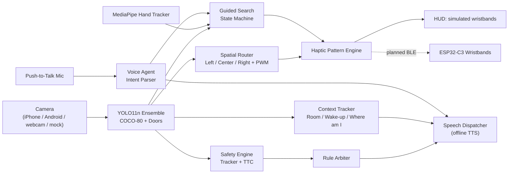

# Nethra — Complete Project Overview

> **Purpose of this document:** a single, self-contained description of the Nethra project — the problem, the solution, the architecture, what is built today, what is planned, how it will be evaluated, and its known limitations. It is written so that a reader (human or AI assistant) can produce a **project proposal** from this file alone.
>
> **Repository:** https://github.com/MahenDulnith/Nethra
> **Institution context:** University of Sri Jayewardenepura (USJ), Sri Lanka
> **Document date:** October 2026

> [!IMPORTANT]
> **Status legend used throughout:**
> - ✅ **Built** — implemented in this repository, runs, and is covered by tests
> - 🟡 **Partial** — code exists but is incomplete, simulated, or not wired end-to-end
> - ⬜ **Planned** — designed/documented only, not yet implemented
>
> When writing a proposal, describe ✅ items as completed work, 🟡 items as in progress, and ⬜ items as proposed work. Do **not** present planned items as finished.

---

## 1. One-Paragraph Summary

**Nethra** (Sinhala/Sanskrit for "eye") is an edge-AI assistive navigation system for blind and visually impaired people (VIPs). A forward-facing camera (in the future, mounted on glasses) feeds a real-time object detector (YOLO11n) running **fully offline** on local hardware. Detected obstacles are mapped to **left / center / right zones** and converted into **vibration intensity on two haptic wristbands** (left wrist = obstacle on the left, both = obstacle ahead, right wrist = obstacle on the right). This "ears-free" design keeps the user's hearing available for traffic and ambient sound. On top of obstacle awareness, Nethra offers **guided object search** ("find the door / bottle", including hand-to-object guidance with fingertip tracking), **push-to-talk voice commands**, **spoken scene descriptions**, and **room/context recognition** (for example, a "good morning, you are in bed" greeting).

---

## 2. Problem Statement

Blind and visually impaired people face daily mobility and independence challenges that current tools only partly address:

1. **White canes** detect only ground-level obstacles within arm's reach. They cannot detect head- or chest-height hazards (open truck gates, overhanging branches, signboards) or help locate a distant target such as a door or a chair.
2. **Audio-heavy smartphone apps** speak constantly. This causes cognitive fatigue and, more importantly, **masks the natural sounds** VIPs rely on (traffic, footsteps, echoes).
3. **Cloud-dependent vision assistants** have multi-second latency and fail when the mobile connection drops. That makes them unsuitable for real-time collision avoidance.
4. **Finding objects** (a door, a bottle, a laptop) in an unfamiliar or rearranged room is still a manual, trial-and-error task.
5. **Local context:** Sri Lankan urban environments (crowded roads, three-wheelers, uneven pavements, open drains) are poorly represented in mainstream assistive-tech datasets and products. Affordable, offline-capable solutions are scarce.

> [!NOTE]
> *For the proposal writer:* back up the problem with real statistics, e.g. WHO global visual-impairment figures and Sri Lanka–specific prevalence data. These are **not** included here and must be sourced and cited. Do not invent numbers.

---

## 3. Proposed Solution

### 3.1 Core idea: a dual-loop, ears-free assistant

| Loop | Purpose | Characteristics |
|---|---|---|
| **Fast loop (safety)** | Obstacle detection → directional vibration | 100% offline, deterministic, real-time (~30 FPS target) |
| **Slow loop (context)** | Scene description, room recognition, voice Q&A, guided search | Runs alongside without blocking the safety loop; speech is sparse and on demand |

### 3.2 Design principles

1. **Safety first and offline.** Critical alerts never depend on the internet.
2. **Haptics before speech.** Direction and proximity are conveyed by vibration. Speech is reserved for on-demand answers and important events.
3. **Honesty.** The system never says "safe to cross" or "all clear". Such phrases are actively blocked in code (`services/voice/speech_dispatcher.py`). Distance is given in coarse buckets, never fake metric values.
4. **Silence must mean "clear", never "broken"** (fail-safe principle; see §6.4).
5. **Assistive, not a replacement.** Nethra complements the white cane; it does not replace it.
6. **Cross-platform and low-cost.** Runs on macOS (Apple Silicon) and Windows today, and targets low-cost embedded hardware next.

---

## 4. Aim & Objectives

**Aim:** Design, build, and evaluate a low-cost, offline, wearable-ready assistive vision system that improves obstacle awareness and object finding for visually impaired users through directional haptic feedback and minimal voice interaction.

**Objectives:**
1. Build a real-time object detection pipeline (80 COCO classes plus a custom fine-tuned door model) that runs offline on consumer hardware. ✅
2. Develop a spatial routing algorithm that converts detections into left/right wristband vibration intensity. ✅
3. Implement guided object search with head and hand guidance using fingertip tracking. ✅
4. Provide push-to-talk voice commands and spoken scene summaries. ✅
5. Implement context awareness (room classification, wake-up routine, "Where am I?"). ✅
6. Build dual ESP32-C3 BLE haptic wristbands and connect them to the vision pipeline. 🟡
7. Port the pipeline to a wearable pocket unit (Raspberry Pi 5 + Hailo-8L NPU) with glasses-mounted camera. ⬜
8. Add ground-drop/stair detection (depth or Time-of-Flight sensor) and a "camera obscured" fail-safe. ⬜
9. Evaluate with benchmarks and, with ethical approval, supervised trials with visually impaired participants. ⬜

---

## 5. System Architecture

### 5.1 Layered software architecture (L0–L5)

The codebase follows a strict layered architecture. Each layer may depend only on layers below it, and this is **enforced automatically** by `ci/dependency_graph_check.py`.

| Layer | Folder | Responsibility |
|---|---|---|
| **L0 Contracts** | `contracts/` | Platform-free data types: `Detection`, `FrameData`, `HapticCommand`, `SafetyAlert`, `VisionResult` |
| **L1 Adapters** | `adapters/` | Hardware abstraction: cameras, microphone, haptic pattern engine, clock, storage |
| **L2 Services (safety)** | `services/safety`, `services/hygiene`, `services/arbiter` | YOLO ensemble, spatial router, tracker, time-to-contact estimator, frame-quality checks, rule arbiter |
| **L3 Services (intelligence)** | `services/voice`, `services/agent`, `services/vision`, `services/memory` | Offline TTS, speech dispatcher, voice agent |
| **L4 Features** | `features/` | User workflows: guided search ("look-around"), context routines, people, failsafe |
| **L5 Shell** | `shell/`, `main.py` | Application wiring, OpenCV heads-up display, CLI |

Supporting folders: `config/` (YAML thresholds, classes, phrasebook, haptic patterns), `tests/` (unit tests), `ci/` (architecture and safety linters), `harness/` (benchmarks and session replay), `firmware/` (ESP32 wristband), `training/`, `datasets/`, `models/`, `docs/`.

### 5.2 Data flow (current desktop prototype)



### 5.3 Target hardware architecture (future wearable)

| Component | Planned hardware | Role |
|---|---|---|
| Glasses | Lightweight frame + ultra-wide camera + microphone + bone-conduction speaker | Sensing and audio, with no heavy compute on the head |
| Pocket compute | Raspberry Pi 5 + Hailo-8L AI HAT+ (13 TOPS) | Runs the detection pipeline at 30+ FPS |
| Wristbands (×2) | ESP32-C3 + TI DRV2605L haptic driver + LRA vibration motor | Left/right tactile output over BLE |
| Extra sensors | VL53L5CX downward Time-of-Flight, BNO085 IMU | Ground-drop detection, head-tilt compensation |

---

## 6. Features in Detail

### 6.1 Real-time object detection ✅
- **Model:** Ultralytics **YOLO11 Nano** (`yolo11n.pt`), all 80 COCO classes.
- **Custom model:** `nethra_doors_yolo11n.pt`, fine-tuned for doors (COCO has no "door" class) using `train.py` with Apple M4 GPU (MPS) or CUDA acceleration.
- **Dual-model ensemble:** both models run on each frame. Overlapping boxes are merged with IoU-based deduplication (IoU 0.45). A **multi-bed disambiguation** rule fixes a common confusion where extra beds are labelled "table/chair/couch".
- **Hardware auto-selection:** CUDA → Apple MPS → CPU.
- File: `services/safety/yolo_ensemble.py`

### 6.2 Spatial routing → haptic intensity ✅
- The frame is split into three vertical zones: **Left** (x < W/3), **Center**, **Right** (x > 2W/3).
- **Proximity proxy:** bounding-box area ratio = (box width × height) / (frame width × height). This is mapped linearly to **0–100% PWM** between a minimum (≈2%) and maximum (≈35%) area ratio.
- Left zone → left wristband; right zone → right wristband; center → **both**.
- File: `services/safety/spatial_router.py`

### 6.3 Haptic pattern engine ✅ (output currently simulated on screen)
- Proportional vibration intensity, error-scaled pulse period during guided search (0.8 s → 0.2 s as the user gets closer to the target), a distinctive "da-DUM" double pulse on alignment, and a **safety override** (an obstacle at ≥80% intensity overrides guidance).
- Today the wristband output is shown as live gauges in the HUD. Sending it to the physical wristbands is the next hardware milestone.
- File: `adapters/haptic/pattern_engine.py`

### 6.4 Safety engine, frame hygiene & arbiter 🟡
- **Multi-object tracker** with class-stability filtering (ignores single-frame misclassifications) ✅
- **Time-to-contact (TTC) estimator** based on bounding-box growth over time ✅
- **Frame hygiene:** blur, darkness/luminance, and occlusion checks ✅ (modules exist and are tested)
- **Rule arbiter:** priority matrix, cooldowns, duplicate suppression, channel policy ✅
- **"I cannot see" fail-safe** (camera blocked → distinctive vibration plus spoken warning) ⬜ planned
- Files: `services/safety/`, `services/hygiene/`, `services/arbiter/`

### 6.5 Guided object search ("look-around") ✅
- State machine: `IDLE → SEARCHING → HEAD_GUIDE → HAND_GUIDE ⇄ ALIGNED`.
- **Temporal confirmation:** the target must be seen in several frames before guidance starts, which avoids false starts.
- **Head guidance:** vibration steers the user to turn toward the target.
- **Hand guidance:** MediaPipe Hand Landmarker tracks the index fingertip and steers the hand to the object (±8% alignment tolerance).
- **Scene memory:** remembers where a target was last seen.
- Files: `features/lookaround/guidance.py`, `services/safety/hand_tracker.py`

### 6.6 Push-to-talk voice agent ✅
- Press **V** or **Space** to speak. Speech recognition runs in a background thread so the video loop never freezes.
- A natural-language intent parser with synonym handling covers all 80 detectable classes. Examples: *"find my laptop"*, *"where is the door?"*, *"what do you see?"*, *"where am I?"*, *"stop"*.
- **Scene summary** (key **D**): groups visible objects by zone ("On your left: a chair. Ahead: a door…").
- Offline speech output: macOS `say`, Windows SAPI5.
- Files: `adapters/audio/mic_listener.py`, `services/agent/voice_agent.py`, `features/lookaround/commands.py`, `services/voice/`

> [!NOTE]
> The speech-to-text step uses the `SpeechRecognition` library. Depending on the backend selected, it may need internet access. A fully on-device STT model (e.g. Whisper) is planned.

### 6.7 Context awareness ✅
- **Room classification** from detected objects: Computer Laboratory, Bedroom, Living Room, Kitchen, Outdoors.
- **Wake-up routine:** a bed visible at start-up triggers *"Good morning! You are in your bed right now."*
- **"Where am I?"** (key **W**): combines a configured location (e.g. University of Sri Jayewardenepura, from `config/locations.json`) with the inferred room and the objects in view.
- File: `features/context_routines/context_tracker.py`

### 6.8 Multi-camera support ✅
- macOS + iPhone (Continuity Camera, ultra-wide 0.5×), Windows + Android (DroidCam / IP Webcam over USB-ADB or Wi-Fi), laptop webcams, video files, and a **synthetic mock camera** for hardware-free testing. Cameras can be switched live (key **C**).
- Folder: `adapters/camera/`

### 6.9 Heads-up display (developer/demo view) ✅
- High-DPI OpenCV/Pillow overlay showing detections, zones, live left/right wristband gauges, guided-search reticle and arrows, FPS, and status banners. Used for demonstrations and debugging. The blind user relies on haptics and audio, not the screen.
- File: `shell/hud/opencv_hud.py`

### 6.10 Wristband firmware 🟡
- `firmware/wristband-esp32/wristband-esp32.ino` (~350 lines): NimBLE GATT service, a 12-byte command format, a pattern ID set (turn left/right, found, obstacle near, urgent, fault, low battery), DRV2605 driver, firmware-side intensity comfort cap (85%), fixed left/right identity at flash time, and LED/buzzer indicators.
- The modular `.cpp` files in that folder are **empty placeholders**. The Python side does **not yet have a BLE client**, so wristbands are not yet driven by the live pipeline.

---

## 7. Technology Stack

| Area | Technology |
|---|---|
| Language | Python 3.13 (desktop), C++/Arduino (ESP32 firmware) |
| Computer vision | OpenCV, Ultralytics YOLO11n, PyTorch (CUDA / Apple MPS / CPU) |
| Hand tracking | Google MediaPipe Hand Landmarker |
| Speech | SpeechRecognition + sounddevice (STT); macOS `say` / Windows SAPI5 (TTS) |
| UI / HUD | OpenCV + Pillow (TrueType rendering) |
| Config | YAML / JSON |
| Firmware | ESP32-C3, NimBLE-Arduino, Adafruit DRV2605 |
| Dev hardware | Apple M4 Mac, Windows laptop with NVIDIA RTX 4060 |
| Quality | `unittest` (63 tests), custom CI linters (dependency graph, phrasebook, thresholds) |
| Version control | Git + GitHub, multi-contributor |

---

## 8. Current Implementation Status

| Component | Status | Evidence |
|---|---|---|
| Layered L0–L5 architecture + dependency CI check | ✅ | `ci/dependency_graph_check.py` passes, 0 violations |
| YOLO11n + custom doors ensemble | ✅ | `services/safety/yolo_ensemble.py`, `models/` |
| Door model fine-tuning pipeline | ✅ | `train.py`, `datasets/doors/` |
| 3-zone spatial routing → PWM | ✅ | `services/safety/spatial_router.py` + tests |
| Haptic pattern engine | ✅ (simulated output) | `adapters/haptic/pattern_engine.py` + tests |
| Tracker + TTC + frame hygiene + rule arbiter | ✅ | `services/safety`, `services/hygiene`, `services/arbiter` + tests |
| Guided search + hand guidance | ✅ | `features/lookaround/guidance.py` + tests |
| Push-to-talk voice agent + scene summary | ✅ | `services/agent/voice_agent.py` + tests |
| Room classification, wake-up, "Where am I?" | ✅ | `features/context_routines/` + tests |
| Multi-camera (Mac/iPhone, Windows/Android, mock) | ✅ | `adapters/camera/` + tests |
| Offline TTS (macOS + Windows) | ✅ | `services/voice/offline_tts.py` |
| Safety phrase blocking ("safe to cross", "all clear") | ✅ | `services/voice/speech_dispatcher.py` + tests |
| Automated tests | ✅ | **63 unit tests passing** |
| ESP32 wristband firmware | 🟡 | `.ino` sketch written; modular files empty; not hardware-validated in repo |
| Python ↔ wristband BLE link | ⬜ | Not implemented |
| "Camera obscured" fail-safe | ⬜ | Planned |
| Ground drop / stairs detection (depth/ToF) | ⬜ | Planned; currently **not detected** |
| Raspberry Pi 5 + Hailo-8L port, ONNX/INT8 export | ⬜ | Planned |
| Glasses hardware enclosure | ⬜ | `hardware/` folders are placeholders |
| Sinhala / Tamil voice | ⬜ | English only |
| On-device STT (Whisper) | ⬜ | Planned |
| Cloud vision-language model for rich descriptions | ⬜ | Planned (optional, never in the safety loop) |
| Offline map (OpenStreetMap) hazard memory | ⬜ | Planned |
| User trials with VIPs | ⬜ | Requires ethics approval |

### 8.1 Measured results so far
Taken from `docs/results_log.md`, the only approved source for numbers:

| Metric | Value | Method |
|---|---|---|
| Glass-to-speech software latency | **median 34.3 ms, p95 37.2 ms** | `frame.capture → speech.dispatch`, 50 trials, NVIDIA RTX 4060 Laptop GPU (CUDA) |
| Memory recall hit@1 (benchmark) | 19/24 = 79.2% | Scripted-day benchmark (`harness/bench/memory_recall_bench.py`). The memory feature is not part of the current main build. |

> [!WARNING]
> Detector FPS, detection accuracy (mAP), haptic comprehension, and user-study figures have **not yet been formally measured**. The proposal should list them as *planned evaluation metrics*, not results. The software latency above excludes camera USB transfer time and physical motor response.

---

## 9. Methodology & Development Approach

1. **Iterative prototyping:** desktop prototype first (fast iteration on laptop GPU), then embedded port.
2. **Layered, testable architecture:** platform-free contracts and adapters let the same logic run on Mac, Windows, and later Raspberry Pi.
3. **Transfer learning:** fine-tune YOLO11n on door and home-object datasets (HomeObjects-3K, Roboflow door datasets) instead of training from scratch.
4. **Test-driven safety rules:** state machines, arbiter priorities, and forbidden-phrase blocking are covered by unit tests. CI linters enforce architecture rules.
5. **Benchmark harness:** `harness/bench/` includes latency, detector, false-match, hallucination, warning-time, and offline benchmarks, plus session replay for reproducible testing.
6. **Honest reporting:** all figures go through `results_log.md` with median/p95, trial counts, and hardware stated.

---

## 10. Proposed Work Plan (Roadmap)

| Phase | Duration | Key deliverables | Exit criteria |
|---|---|---|---|
| **1. Desktop prototype** | Done | Detection ensemble, spatial haptics, guided search, voice agent, context, HUD, L0–L5 architecture | ✅ 63 tests passing, live demo working |
| **2. Hardware wristbands** | Weeks 1–4 | ESP32-C3 + DRV2605L + LRA ×2, Python BLE client, 200 ms heartbeat watchdog | Wristbands driven live; 60-min soak test without disconnect |
| **3. Safety hardening** | Weeks 3–6 | "Camera obscured" fail-safe, class-agnostic "obstacle ahead" fallback, TTC escalation tuned | Fail-safe triggers within 0.5 s of occlusion |
| **4. Wearable port** | Weeks 5–10 | ONNX/INT8 export, Raspberry Pi 5 + Hailo-8L, glasses camera mount, ToF drop sensor | ≥ 25–30 FPS on device; measured glass-to-wrist latency |
| **5. Intelligence & language** | Weeks 8–12 | On-device STT, Sinhala/Tamil audio prompts, optional cloud VLM with runtime safety guard | Native-speaker review of prompts |
| **6. Evaluation & trials** | Months 4–6 | Benchmarks; supervised indoor trials with 3–5 VIPs (with ethics approval, alongside white cane) | Targets in §11 |

> Adjust the durations to the actual academic calendar and submission deadlines.

---

## 11. Evaluation Plan

| Metric | How it will be measured | Target (proposed) |
|---|---|---|
| End-to-end latency (camera → wristband vibration) | LED-flash → accelerometer-on-wristband rig, median & p95 | ≤ 100 ms software target; physical latency to be reported honestly |
| Detection performance | mAP@0.5 on validation sets (COCO subset, doors) | Report per class |
| Hazard recall | Scripted obstacle courses, % of obstacles signalled in time | ≥ 90% |
| False alert rate | Alerts per minute on obstacle-free routes | Minimise; report with confidence interval |
| Frame rate on target device | FPS on Raspberry Pi 5 + Hailo | ≥ 25 FPS |
| Haptic pattern comprehension | Users identify direction/pattern correctly | ≥ 95% |
| Guided search success | % of trials where the user reaches the object; time to reach it | Report median time |
| Cognitive workload | NASA-TLX questionnaire, with vs. without Nethra | Lower or equal workload |
| Battery life | Continuous-use runtime of pocket unit and wristbands | ≥ 3–4 hours (to be validated) |

---

## 12. Estimated Hardware Bill of Materials (Phase 2+)

| Item | Qty | Purpose |
|---|---|---|
| Raspberry Pi 5 (8 GB) | 1 | Pocket compute |
| Raspberry Pi AI HAT+ (Hailo-8L) | 1 | Neural accelerator |
| Ultra-wide USB / CSI camera module | 1 | Glasses camera |
| ESP32-C3 dev boards | 2 | Wristband controllers |
| TI DRV2605L haptic driver boards | 2 | Motor drivers |
| LRA / ERM vibration motors | 2–4 | Haptic actuators |
| VL53L5CX Time-of-Flight sensor | 1 | Ground-drop detection |
| BNO085 IMU | 1 | Head-tilt compensation |
| Li-Po batteries + chargers, power bank | 3 | Power |
| Bone-conduction headset / speaker | 1 | Audio output |
| 3D-printed enclosures, straps, glasses frame | — | Wearable form factor |

> [!NOTE]
> Unit prices (LKR/USD) are **not** included. Fill them in from local suppliers before submitting a budget section.

---

## 13. Ethics, Safety & Privacy

- **Assistive, not a replacement:** users are told the white cane remains the primary mobility aid.
- **No false reassurance:** phrases like "safe to cross" and "all clear" are blocked in code.
- **Offline by default:** camera frames are processed locally. Nothing is uploaded in the safety loop.
- **User trials** require approval from a university ethics committee, informed consent (in accessible formats and in Sinhala/Tamil/English), supervision, and a sighted safety assistant.
- **Privacy:** any future face recognition ("person memory") would need explicit consent from the people enrolled. The current build does not include it.
- **Licensing:** Ultralytics YOLO is AGPL-3.0, which matters for future distribution or commercialisation. Track licences in `docs/citations.md`.
- **Comfort:** wristband firmware enforces a maximum vibration intensity cap.

---

## 14. Known Limitations (current build)

- **Does not detect drop-offs, holes, open drains, kerbs, or stairs going down.** These need a depth or ToF sensor (planned).
- **Glass doors and transparent obstacles** are frequently missed by the detector.
- **Distance is approximate:** proximity comes from bounding-box size, which depends on the object's real size. A large distant object and a small near object can look similar. No metric depth.
- **Forward-facing only:** nothing behind or far to the side is detected.
- **Overhead obstacles** outside the camera's field of view are missed.
- **English only** for now.
- **Wristbands are simulated on screen.** A physical BLE link is not yet implemented.
- **Desktop-tethered:** the current prototype needs a laptop and a phone/webcam.
- **Not yet evaluated with visually impaired users.**
- **Speech recognition** may rely on an online backend depending on configuration.

See `docs/limitations.md` for a longer list.

---

## 15. Expected Outcomes & Impact

- A working, low-cost, offline assistive prototype adapted to Sri Lankan settings.
- An open, modular codebase (L0–L5) that others can extend to new hardware.
- Evidence (benchmarks and pilot user feedback) on whether directional haptics reduce cognitive load compared to audio-only assistants.
- A pathway to an affordable wearable product: glasses + pocket unit + two wristbands.
- Possible partnerships: Sri Lanka Council for the Blind, USJ research groups, local schools for the blind.

---

## 16. Team & Roles

| Member | GitHub | Role |
|---|---|---|
| Member 1 — Mahen Dulnith | `MahenDulnith` | Project lead; vision and ML (model selection, fine-tuning, ensemble, hand tracking, HUD, voice agent); demo lead |
| Member 2 — Sahan Chathuranga Herath | `sahanchathurangaherath` | Systems and safety lead (L0–L5 architecture, camera adapters, tracker/TTC, rule arbiter, Windows/Android support, benchmarks) |
| Member 3 — *[name]* | — | Hardware and firmware lead (ESP32-C3 wristbands, Raspberry Pi 5 + Hailo, sensors, enclosures) |

> Fill in full names, registration numbers, supervisor name, and degree programme.

---

## 17. How to Run (for reviewers)

```bash
python -m venv .venv
source .venv/bin/activate          # Windows: .venv\Scripts\Activate.ps1
pip install -r requirements.txt
pip install mediapipe              # needed for hand tracking (not yet in requirements.txt)

python main.py --mock              # no camera needed
python main.py --camera 1          # macOS iPhone Continuity Camera / DroidCam
python main.py --camera-url http://127.0.0.1:8080/video   # Android IP Webcam

python -m unittest discover -s tests   # 63 tests
```

**Controls:** `V`/`Space` voice · `D` describe scene · `F` find door · `B` find bottle · `X` cancel · `W` where am I · `C` switch camera · `M` mute · `Q` quit.

---

## 18. Glossary

| Term | Meaning |
|---|---|
| VIP | Visually impaired person |
| YOLO11n | "You Only Look Once" v11 Nano: a fast, small real-time object detector |
| COCO-80 | The 80 everyday object classes of the COCO dataset |
| Ensemble | Running two models and merging their detections |
| IoU | Intersection over Union: overlap measure between two boxes |
| PWM | Pulse-width modulation: controls vibration strength (0–100%) |
| LRA | Linear resonant actuator: a precise vibration motor |
| TTC | Time-to-contact, estimated from how fast an object's box grows |
| BLE | Bluetooth Low Energy |
| NPU / Hailo-8L | Neural processing unit / AI accelerator chip for Raspberry Pi |
| ToF | Time-of-Flight distance sensor |
| HUD | Heads-up display (on-screen developer/demo overlay) |
| STT / TTS | Speech-to-text / text-to-speech |

---

## 19. Notes for an AI Assistant Writing the Proposal

1. Use **§8 Current Implementation Status** as the source of truth for what is done.
2. Use only the numbers in **§8.1**. Mark every other figure as a target or planned measurement.
3. Add **real, cited** literature for the background and related-work sections. Suggested topics to research: WHO visual-impairment statistics; Sri Lanka visual-impairment prevalence; existing aids (white cane, guide dogs, WeWALK smart cane, Microsoft Seeing AI, Envision Glasses, OrCam MyEye, Be My Eyes); research on haptic navigation belts/wristbands; YOLO object detection; MediaPipe hands. Do not fabricate references.
4. Keep the safety framing: Nethra **complements** the white cane.
5. Placeholders still to fill: Member 3 name, supervisor, registration numbers, budget prices, exact timeline dates.
