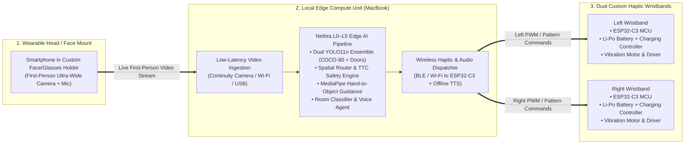

# Nethra: Complete Project Specification & Proposal Reference

> **Purpose of This Document:** This is the complete, self-contained technical and academic reference for the **Nethra** project. It is structured specifically so that a reader or an AI assistant (such as Claude AI) can generate a complete, formal **University Project Proposal** directly from this file and repository.
>
> **Project Title:** *Nethra: Edge-AI Assistive Vision, Dual-Wristband Spatial Haptics, and Guided Micro-Navigation for the Visually Impaired*  
> **Repository:** `https://github.com/MahenDulnith/Nethra.git`  
> **Institution Context:** University of Sri Jayewardenepura (USJ), Sri Lanka  
> **Date:** October 2026

---

## 1. Executive Summary (Abstract)

**Nethra** (derived from the Sinhala and Sanskrit word for *"Eye"*) is a wearable, ears-free, edge-AI assistive perception and navigation system designed for blind and visually impaired people (VIPs). Traditional mobility aids such as the white cane cannot detect chest- or head-height hazards or locate distant targets (such as doors, chairs, or personal items), while smartphone voice apps overwhelm the user with continuous spoken chatter that masks vital environmental sounds (approaching traffic, footsteps, and natural echolocation). Cloud-based vision systems suffer from multi-second network latency and connectivity dropouts, making them unsafe for real-time obstacle avoidance.

Nethra solves these problems through a cost-effective, high-performance **Wearable Tri-Partite Edge Architecture** coupled with a **Dual-Loop Hybrid Perception Engine**:
1. **Wearable Smart Glasses / Head-Mounted Phone Holder:** A custom head/face mount holds a smartphone at eye level, capturing a stable, hands-free, first-person ultra-wide video stream and feeding it in real time to the local Mac compute unit.
2. **Local Edge Compute Unit (Mac with Apple Silicon GPU Acceleration):** Runs the complete **L0–L5 Nethra AI Pipeline** 100% offline at 30+ FPS—combining a **Dual-Model YOLO11n Ensemble** (80 COCO classes + a custom fine-tuned Door detector), **3-Zone Spatial Routing**, **Multi-Object Tracking with Time-to-Contact (TTC) Estimation**, **MediaPipe Hand-to-Object Micro-Navigation**, **Contextual Room Classification**, and a **Push-to-Talk Voice Agent**.
3. **Dual Custom Wireless Haptic Wristbands (Left & Right):** Two self-contained wearable wristbands—each built with an **ESP32-C3 microcontroller**, **vibration actuator & driver**, **rechargeable Li-Po battery**, and **on-board battery charging controller**—connect wirelessly to the Mac and translate obstacle direction and proximity into intuitive tactile vibrations on the left wrist, right wrist, or both wrists simultaneously.

By conveying continuous spatial awareness through touch (**haptics-first, ears-free**) and reserving spoken audio strictly for critical warnings and on-demand voice queries, Nethra empowers visually impaired users to navigate indoor and outdoor environments safely, locate everyday objects independently, and preserve their natural hearing.

---

## 2. Background & Problem Statement

### 2.1 Challenges Faced by Visually Impaired Individuals
Navigating everyday indoor and outdoor spaces requires continuous spatial awareness: knowing what obstacles lie ahead, which direction is clear, how fast hazards are approaching, and where target objects (doors, chairs, tables, bottles, laptops) are located. Visually impaired individuals face five core limitations with existing assistive tools:

1. **Range & Height Blindness of White Canes:** While the white cane is essential for ground-level tactile feedback within 1–1.5 meters, it cannot detect overhanging or elevated obstacles (signboards, tree branches, open vehicle tailgates, tabletops) and cannot locate distant targets across a room (such as an exit door or an empty seat).
2. **Auditory Overload ("Ears-Blocked" Hazard):** Most smartphone assistive apps rely on continuous Text-to-Speech (TTS) narration. Constant spoken output causes severe cognitive fatigue and **masks critical ambient acoustic cues** (approaching vehicles, cyclists, horns, footsteps, and room reverberation) that blind travelers depend on for survival.
3. **Cloud Latency & Connectivity Failures:** Vision assistants that upload camera frames to cloud servers experience 1.5–5.0 seconds of round-trip delay and fail completely in areas with poor cellular reception or high data costs—rendering them unusable for real-time collision avoidance.
4. **Difficulty Locating Everyday Objects ("Last-Meter" Problem):** Even inside familiar homes, classrooms, or laboratories, finding a dropped or misplaced item (a water bottle, cup, phone, or backpack) or aligning one's hand to grasp it requires tedious manual sweeping.
5. **High Hardware Cost of Commercial Smart Glasses:** Commercial assistive wearables (such as Envision Glasses or OrCam MyEye) cost USD \$2,500–\$4,500, and even dedicated embedded AI kits (industrial CSI cameras + Raspberry Pi 5 + dedicated NPU HATs) remain expensive and bulky to mount on the head. There is a pressing need for a **student-buildable, affordable architecture** that leverages existing consumer devices (smartphone camera + laptop edge compute) paired with low-cost custom wearable electronics (dual ESP32-C3 wristbands and a custom head mount).

---

## 3. Proposed Solution & System Concept

### 3.1 Practical, Cost-Effective Hardware Architecture
To achieve high-speed deep learning inference (30+ FPS) and ergonomic wearability without purchasing expensive proprietary smart-glasses cameras or dedicated embedded NPU boards, Nethra uses a **three-part wearable hardware architecture**:



1. **Custom Head-Mounted Glasses / Phone Holder (First-Person Vision Sensor):**
   - A lightweight, ergonomic head/face mount holds the user's smartphone at eye level, acting as wearable smart glasses.
   - Provides a stabilized, head-steered first-person field of view (including Ultra-Wide `0.5x` coverage) and streams live video to the Mac via macOS Continuity Camera, Wi-Fi IP stream, or USB.
2. **Mac Edge Compute Unit (High-Speed Local AI Brain):**
   - Runs the entire Nethra perception, tracking, safety arbitration, and voice pipeline locally on Apple Silicon (M-series GPU via Metal Performance Shaders) or Windows GPU/CPU.
   - Processes frames in real time ($\sim 30\text{ FPS}$) completely offline, ensuring zero cloud latency for safety alerts.
   - Connects wirelessly to **both ESP32-C3 wristbands** to dispatch real-time left and right tactile feedback commands.
3. **Dual Self-Contained ESP32-C3 Haptic Wristbands (Left & Right Tactile Actuators):**
   - Two independent custom-built wristbands worn on the left and right wrists.
   - Each wristband integrates:
     - **ESP32-C3 Microcontroller** with integrated BLE 5.0 / Wi-Fi antenna
     - **Rechargeable Li-Po Battery** (3.7V lithium-polymer cell) for untethered wearable operation
     - **Battery Charging Controller Module** (TP4056 / USB-C charge management IC with over-charge, over-discharge, and short-circuit protection)
     - **Haptic Motor & Driver Circuit** (DRV2605L / PWM MOSFET driver + LRA/ERM vibration motor) with a firmware-enforced comfort cap (`85%` max intensity)

### 3.2 Dual-Loop Perception Philosophy
* **The Fast Loop (Real-Time Obstacle & Haptic Safety Loop — 100% Offline, 30 FPS):** Continuously detects obstacles, tracks object motion and closing speed (TTC), partitions the field of view into **Left / Center / Right** spatial zones, and modulates the left and right wristband vibration intensities.
* **The Slow Loop (On-Demand Voice, Guided Search & Context Loop — Event-Driven):** Handles natural-language Push-to-Talk voice commands (*"Find the door"*, *"Find my bottle"*, *"What do you see?"*, *"Where am I?"*), indoor room classification, morning wake-up greetings, and hand-to-object alignment without ever blocking the Fast Loop.

---

## 4. Project Aim & Specific Objectives

### 4.1 Overall Aim
To design, build, and evaluate **Nethra**, a cost-effective, offline-capable edge-AI assistive vision system combining a head-mounted smartphone camera, Mac edge inference, and dual rechargeable ESP32-C3 haptic wristbands to provide ears-free obstacle navigation, guided object search, and contextual scene awareness for visually impaired individuals.

### 4.2 Specific Objectives
1. **Dual-Model Edge Object Detection:** Develop and fine-tune a real-time YOLO11n ensemble combining 80 everyday COCO classes with a custom fine-tuned indoor **Door detection model** (`nethra_doors_yolo11n.pt`), using IoU deduplication and multi-bed disambiguation.
2. **3-Zone Spatial Routing & Proportional Haptics:** Formulate and implement a spatial routing engine that maps object horizontal position (`LEFT`, `CENTER`, `RIGHT`) and bounding-box area ratios into proportional `0–100%` PWM vibration intensities across dual wristbands.
3. **Temporal Tracking, TTC & Deterministic Safety Arbitration:** Implement multi-object tracking with class-stability filtering, bounding-box growth Time-to-Contact (TTC) estimation, frame-hygiene validation (blur, darkness, occlusion), and a deterministic rule arbiter that prevents false safety assurances.
4. **Guided Object Search & Hand-to-Object Alignment:** Build an interactive state machine (`IDLE → SEARCHING → HEAD_GUIDE → HAND_GUIDE ⇄ ALIGNED`) integrating **MediaPipe Hand Landmarker** fingertip tracking to guide a user's head and hand directly to a target object via error-scaled haptic pulses.
5. **Push-to-Talk Voice Agent & Contextual Room Intelligence:** Implement a non-blocking voice assistant supporting natural-language search across 80+ object classes, zone-grouped scene descriptions, automatic indoor room classification (`Computer Laboratory`, `Bedroom`, `Living Room`, `Kitchen`, `Outdoors`), and wake-up routines.
6. **Hardware Fabrication (Dual ESP32-C3 Wristbands & Face Phone Mount):** Design and assemble two wireless haptic wristbands (each with an ESP32-C3, Li-Po battery, charging controller, and vibration actuator) and a wearable head/face smartphone mount, integrating wireless Mac-to-wristband communication.
7. **System Evaluation & Verification:** Evaluate end-to-end latency, detection accuracy, spatial routing reliability, and guided-search performance through automated unit tests (63 tests across L0–L5 layers), benchmark suites, and live indoor navigation trials.

---

## 5. Software & AI Architecture (L0–L5 Modular Design)

Nethra's codebase is organized into a strict **6-layer architecture (`L0` through `L5`)**. Lower layers never import from higher layers, and this invariant is automatically verified in CI via `ci/dependency_graph_check.py`.

```mermaid
flowchart TD
    subgraph L5 ["L5: Shell & Presentation Layer (shell/, main.py)"]
        CLI["Root Pipeline Launcher (main.py)"]
        HUD["Retina 2x High-DPI OpenCV/TrueType HUD (shell/hud/opencv_hud.py)"]
    end

    subgraph L4 ["L4: User Feature Workflows (features/)"]
        GUIDE["Guided Search State Machine (features/lookaround/guidance.py)"]
        INTENT["80-Class Natural Language Intent Parser (features/lookaround/commands.py)"]
        CTX["Context & Room Classifier (features/context_routines/context_tracker.py)"]
    end

    subgraph L3 ["L3: Intelligence & Interaction Services (services/agent/, services/voice/)"]
        VAGENT["Push-to-Talk Voice Agent & Scene Summarizer (voice_agent.py)"]
        SDISP["Speech Dispatcher & Forbidden-Phrase Guard (speech_dispatcher.py)"]
        TTS["Cross-Platform Offline TTS Engine (offline_tts.py)"]
    end

    subgraph L2 ["L2: Core Perception, Safety & Arbitration (services/safety/, hygiene/, arbiter/)"]
        ENSEMBLE["Dual YOLO11n Ensemble: COCO-80 + Custom Doors (yolo_ensemble.py)"]
        SROUTER["3-Zone Spatial Router & Area-to-PWM Mapper (spatial_router.py)"]
        HAND["MediaPipe Index-Finger Hand Tracker (hand_tracker.py)"]
        SENG["Safety Engine: MultiObjectTracker + TTC GrowthEstimator (safety_engine.py)"]
        HYG["Frame Hygiene: Blur, Luminance & Occlusion Gates (services/hygiene/)"]
        ARB["Deterministic Rule Arbiter, Priority Matrix & Cooldowns (services/arbiter/)"]
    end

    subgraph L1 ["L1: Hardware Abstraction Adapters (adapters/)"]
        CAM_HAL["Multi-Source Camera HAL (Continuity / IP Stream / UVC / Mock)"]
        MIC_HAL["Non-Blocking Push-to-Talk Microphone Listener (mic_listener.py)"]
        HAP_HAL["Haptic Pattern Engine & ESP32-C3 Wireless Bridge (pattern_engine.py)"]
        CLK_HAL["Monotonic Clock Adapter (monotonic_clock.py)"]
    end

    subgraph L0 ["L0: Domain Contracts (contracts/)"]
        TYPES["Detection • FrameData • HapticCommand • SafetyAlert • VisionResult"]
    end

    L5 --> L4 --> L3 --> L2 --> L1 --> L0
```



### Layer Breakdown
| Layer | Directory | Core Modules & Responsibilities |
| :--- | :--- | :--- |
| **L0 — Contracts** | `contracts/` | Pure, dependency-free dataclasses & enums: `Detection`, `FrameData`, `HapticCommand`, `GuidanceState`, `HapticFeedbackState`, `SafetyAlert`, `VisionResult`. |
| **L1 — Adapters** | `adapters/` | Hardware interfaces: `adapters/camera/` (Continuity Camera, Android IP stream, UVC webcam, video file, synthetic mock feed), `adapters/audio/mic_listener.py` (Push-to-Talk microphone capture), `adapters/haptic/pattern_engine.py` (PWM & pulse pattern generator for dual wristbands), `adapters/clock/`. |
| **L2 — Safety & Perception** | `services/safety/`, `services/hygiene/`, `services/arbiter/` | `yolo_ensemble.py` (COCO-80 + Doors ensemble), `spatial_router.py` (Left/Center/Right zone & PWM math), `hand_tracker.py` (MediaPipe index fingertip tracking), `tracker.py` (IoU multi-object tracker with class stability), `growth_estimator.py` (TTC estimation), `safety_engine.py`, `blur_scorer.py`, `luminance_checker.py`, `occlusion_heuristic.py`, `rule_arbiter.py`. |
| **L3 — Voice & Agent** | `services/voice/`, `services/agent/` | `voice_agent.py` (scene summarizer & voice command orchestrator), `speech_dispatcher.py` (cooldowns, barge-in priority, and safety-phrase blocker), `offline_tts.py` (macOS `say` & Windows SAPI5). |
| **L4 — Features** | `features/` | `guidance.py` (`GuidanceStateMachine` for head & hand object finding), `commands.py` (synonym-aware 80-class intent parser), `context_tracker.py` (indoor room inference, bed wake-up detection, and location queries). |
| **L5 — Shell & HUD** | `shell/hud/`, `main.py`, `train.py` | `opencv_hud.py` (Retina 1280×960 TrueType visual telemetry HUD), `main.py` (CLI pipeline orchestrator), `train.py` (Apple Silicon MPS / CUDA fine-tuning CLI). |

---

## 6. Core Algorithms & Mathematical Formulations

### 6.1 Dual-Model YOLO11n Ensemble & Multi-Bed Disambiguation
Standard COCO-80 object detectors recognize 80 common classes (`person`, `chair`, `couch`, `bed`, `dining table`, `bottle`, `cup`, `laptop`, `cell phone`, etc.) but **lack a `door` class**, which is essential for indoor navigation.
1. **Transfer Learning (`train.py`):** We fine-tuned Ultralytics `yolo11n.pt` on custom door datasets (`datasets/doors/data.yaml` and `datasets/HomeObjects-3K.yaml`) using Apple M4 GPU acceleration (`device="mps"`), producing `models/nethra_doors_yolo11n.pt`.
2. **IoU Deduplication:** On every frame, candidates from both models are merged using Intersection-over-Union ($\text{IoU} = 0.45$):
   $$\text{IoU}(A, B) = \frac{\text{Area}(A \cap B)}{\text{Area}(A \cup B)}$$
3. **Contextual Multi-Bed Disambiguation:** In multi-bed rooms (such as dormitories or bedrooms), standard YOLO models frequently misclassify secondary beds as `dining table`, `couch`, or `chair`. When a confirmed `bed` (or strong bed candidate overlapping with a confusable furniture box at $\text{IoU} \ge 0.25$) is present in the scene, `disambiguate_multi_bed_candidates()` relabels those ambiguous furniture detections as `bed`.

### 6.2 3-Zone Horizontal Spatial Routing & Area-to-PWM Mapping
For a video frame of width $W$ and height $H$, each detected bounding box $(x_1, y_1, x_2, y_2)$ has center $x_c = \frac{x_1 + x_2}{2}$ and normalized area ratio:
$$r_{\text{area}} = \frac{(x_2 - x_1) \times (y_2 - y_1)}{W \times H}$$

1. **Horizontal Zone Partitioning:**
   $$\text{Zone}(x_c) = \begin{cases} \text{LEFT}, & 0 \le x_c < \frac{W}{3} \quad \implies \text{Left Wristband Active} \\ \text{CENTER}, & \frac{W}{3} \le x_c \le \frac{2W}{3} \quad \implies \text{Both Left \& Right Wristbands Active} \\ \text{RIGHT}, & \frac{2W}{3} < x_c \le W \quad \implies \text{Right Wristband Active} \end{cases}$$

2. **Proportional PWM Duty Cycle ($0\% - 100\%$):**
   Given minimum activation threshold $r_{\min} = 0.02$ ($2\%$ of frame area) and saturation threshold $r_{\max} = 0.35$ ($35\%$ of frame area):
   $$\text{PWM}(r_{\text{area}}) = \text{clip}\left(\frac{r_{\text{area}} - r_{\min}}{r_{\max} - r_{\min}} \times 100,\; 0.0,\; 100.0\right)$$

### 6.3 Multi-Object Tracking & Time-to-Contact (TTC) Estimation
* **Class-Stability Filtering (`MultiObjectTracker`):** Tracks objects across frames via IoU matching and requires a consistent class history before promoting a detection, eliminating single-frame flicker.
* **Relative Closing-Speed / TTC (`GrowthEstimator`):** Estimates Time-to-Contact from the relative expansion rate of a tracked bounding box's scale $s(t) = \sqrt{w(t) \cdot h(t)}$ over time $\Delta t$:
  $$\text{TTC} \approx \frac{s(t_0)}{\frac{ds}{dt}} = \frac{s(t_0) \cdot \Delta t}{s(t) - s(t_0)} \quad (\text{for } s(t) > s(t_0))$$
  Rapidly expanding obstacles trigger high-priority safety alerts via the `SafetyEngine` and `RuleArbiter`.

### 6.4 Guided Object Search & Hand-to-Object Micro-Navigation
When the user requests a target object (e.g., pressing `[F]` for Door, `[B]` for Bottle, or speaking *"Find my laptop"* via `[V]`/`[Space]`):
1. **`SEARCHING`:** Scans the scene (and checks short-term spatial scene memory for where the object was last seen). Requires temporal confirmation across consecutive frames (`confirm_frames = 2`) before locking on.
2. **`HEAD_GUIDE`:** Computes normalized horizontal offset error $e_x = \frac{x_{\text{target}} - W/2}{W/2} \in [-1, +1]$ and steers the user's head toward the target using directional wristband pulses.
3. **`HAND_GUIDE`:** Once the user's hand enters the frame, **MediaPipe Hand Landmarker** tracks the 3D/2D coordinates of the **index fingertip** $(x_{\text{hand}}, y_{\text{hand}})$ and computes the vector to the target center $(x_{\text{target}}, y_{\text{target}})$.
4. **Error-Scaled Pulse Period & `ALIGNED` Double-Pulse:**
   As the normalized error $|e|$ decreases from $1.0$ to $0.0$, the wristband pulse period shortens linearly from $T_{\max} = 0.80\text{ s}$ to $T_{\min} = 0.20\text{ s}$ (like a parking sensor):
   $$T(|e|) = T_{\min} + \text{clip}(|e|, 0, 1) \cdot (T_{\max} - T_{\min})$$
   When the fingertip aligns within tolerance ($\pm 8\%$ of frame width), the state transitions to **`ALIGNED`**, triggering a synchronized `"da-DUM"` double-pulse on both wristbands and announcing *"Target aligned — reach forward."*
5. **Safety Preemption Invariant:** If any obstacle triggers a safety PWM $\ge 80\%$ during guided search, obstacle avoidance immediately overrides guidance vibrations.

### 6.5 Honest Safety Communication & Forbidden-Phrase Guard
A core ethical rule enforced in `services/voice/speech_dispatcher.py` is that an assistive system must **never give false assurances of safety**. Any outgoing spoken message is scanned against a blocklist (`"safe to cross"`, `"all clear"`, `"path is completely safe"`, `"nothing in your way"`). If detected, `SpeechDispatcher` blocks the utterance immediately. Furthermore, distances are communicated in intuitive qualitative buckets (*"right in front of you"*, *"a couple of steps away"*, *"across the room"*), never uncalibrated metric guesses.

---

## 7. Hardware Design: Wearable Mount & Dual ESP32-C3 Wristbands

### 7.1 Hardware Components & Architecture
The physical hardware built for the final system consists of three integrated subsystems:

| Subsystem | Hardware Components | Function in Final System |
| :--- | :--- | :--- |
| **1. Head-Mounted Smart Glasses / Phone Holder** | • Custom wearable face/head smartphone mount<br/>• Smartphone with Ultra-Wide camera & microphone | Positions the phone camera at eye level on the user's face to stream a hands-free, first-person view to the Mac. |
| **2. Left Haptic Wristband** | • **ESP32-C3** SuperMini / Dev Module (BLE 5.0 / Wi-Fi)<br/>• **3.7V Li-Po Rechargeable Battery** (e.g., 400–600 mAh)<br/>• **Charging Controller Module** (TP4056 USB-C with protection)<br/>• **Haptic Driver & Vibration Motor** (DRV2605L / MOSFET + LRA/ERM motor)<br/>• Custom enclosure & adjustable wrist strap | Receives left-channel wireless haptic commands from the Mac; vibrates proportionally to left-zone and center-zone obstacles or left steering cues. |
| **3. Right Haptic Wristband** | • **ESP32-C3** SuperMini / Dev Module (BLE 5.0 / Wi-Fi)<br/>• **3.7V Li-Po Rechargeable Battery** (e.g., 400–600 mAh)<br/>• **Charging Controller Module** (TP4056 USB-C with protection)<br/>• **Haptic Driver & Vibration Motor** (DRV2605L / MOSFET + LRA/ERM motor)<br/>• Custom enclosure & adjustable wrist strap | Receives right-channel wireless haptic commands from the Mac; vibrates proportionally to right-zone and center-zone obstacles or right steering cues. |
| **4. Host Edge Compute Unit** | • **Apple Silicon MacBook (M4 GPU)** (or Windows laptop)<br/>• Built-in / Bluetooth audio output for TTS & earcons | Runs the Nethra L0–L5 AI vision pipeline at 30+ FPS; receives phone video stream and transmits wireless commands to both ESP32-C3 wristbands. |

### 7.2 Wristband Power & Charging Circuitry
Each wristband is completely wireless and self-powered:
```text
[USB-C 5V Input] ──► [Charging Controller (TP4056 + DW01 Protection)]
                             │
                             ├──► [3.7V Rechargeable Li-Po Battery]
                             │
                             └──► [3.3V Regulator / ESP32-C3 Power Rail]
                                         │
                                         ├──► [ESP32-C3 MCU (BLE / Wi-Fi Receiver)]
                                         └──► [Haptic Motor Driver + Vibration Actuator]
```
* **Charging & Protection:** The charging controller manages constant-current / constant-voltage (CC/CV) charging of the Li-Po cell via USB-C and protects against over-charging ($>4.2\text{ V}$), over-discharging ($<2.5\text{ V}$), and over-current faults.
* **Firmware Safety Cap (`firmware/wristband-esp32/wristband-esp32.ino`):** Each ESP32-C3 is flashed with a fixed side identity (`BAND_SIDE = 0` for Left, `BAND_SIDE = 1` for Right), implements a 12-byte command packet decoder over BLE GATT (`6e400001-b5a3-f393-e0a9-e50e24dcca9e`), monitors battery voltage via ADC, and enforces a hardware comfort cap (`INTENSITY_CAP = 85%`).

### 7.3 Bill of Materials (BOM) for Hardware Fabrication

| Item | Quantity | Specification / Role |
| :--- | :---: | :--- |
| **ESP32-C3 Development Board** (e.g., ESP32-C3 SuperMini) | 2 | Ultra-compact RISC-V MCU with BLE 5.0 & Wi-Fi (1 per wristband) |
| **Rechargeable Li-Po Battery** (3.7V, 400–600 mAh) | 2 | Portable power source for Left and Right wristbands |
| **Li-Po Charging Controller** (TP4056 USB-C with protection) | 2 | On-board battery charging & discharge protection (1 per wristband) |
| **Vibration Motor + Haptic Driver** (DRV2605L + LRA / ERM Coin Motor) | 2 | Tactile vibration actuator & PWM/I2C driver stage |
| **Wearable Head / Face Smartphone Holder** | 1 | Head-mounted glasses/face rig holding the smartphone camera at eye level |
| **Wristband Enclosures, Velcro Straps, Slide Switches & Wiring** | 2 sets | Physical housing, power switch, and wrist straps for both bands |
| **Smartphone & MacBook (Existing Team Equipment)** | 1 + 1 | First-person camera streamer (Smartphone) + Edge AI processor (Mac) |

---

## 8. Interactive Features & User Workflows

### 8.1 Real-Time Obstacle Navigation (Default Mode)
- As the user walks or turns their head with the face-mounted phone camera, Nethra detects obstacles across 80 COCO classes + custom doors.
- Obstacles on the left vibrate the **Left ESP32-C3 wristband**; obstacles on the right vibrate the **Right ESP32-C3 wristband**; obstacles directly ahead vibrate **both wristbands simultaneously** with intensity proportional to proximity.

### 8.2 Push-to-Talk Voice Agent (`[V]` / `[Space]`)
- Pressing `V` or `Space` activates the non-blocking `PushToTalkListener` (`adapters/audio/mic_listener.py`).
- The spoken transcript is parsed by `parse_intent()` (`features/lookaround/commands.py`), which supports natural-language phrasing and synonyms across 80+ object classes:
  - *"Find my laptop"* / *"Where is the door?"* / *"Locate water bottle"* $\to$ Starts Guided Object Search for that target.
  - *"What do you see?"* / *"Describe the scene"* $\to$ Speaks a spatial breakdown of visible objects grouped by `LEFT`, `CENTER`, and `RIGHT` zones.
  - *"Where am I?"* $\to$ Announces building/campus location, inferred indoor room type, and nearby objects.
  - *"Stop"* / *"Cancel"* $\to$ Cancels active search and returns to obstacle navigation.

### 8.3 Contextual Room Classification & Morning Routine
- **Indoor Room Inference (`features/context_routines/context_tracker.py`):** Automatically classifies the surrounding room based on object co-occurrence signatures:
  - **Computer Laboratory:** Multiple monitors/laptops + chairs/keyboards (e.g., USJ Cisco Networking Lab)
  - **Bedroom:** Presence of `bed`
  - **Living Room:** `couch` + `tv` / `chair`
  - **Kitchen / Dining Area:** `refrigerator`, `microwave`, `oven`, `sink`, `dining table` + `bottle`/`cup`
  - **Outdoors / Street:** `car`, `bus`, `truck`, `motorcycle`, `bicycle`, `traffic light`
- **Wake-Up Routine:** Detecting a `bed` upon startup greets the user: *"Good morning! You are in your bed right now."*

### 8.4 High-DPI Retina Developer & Demonstration HUD (`shell/hud/opencv_hud.py`)
- For sighted evaluators, supervisors, and debugging, the Mac displays a razor-sharp `1280×960` Retina HUD rendered with anti-aliased TrueType typography:
  - Dedicated top status bar (Active Mode Badge, Camera ID, Live FPS) and non-overlapping `< LEFT ZONE | ^ CENTER (AHEAD) | RIGHT ZONE >` sub-header strip.
  - Color-coded bounding boxes with smart label pills, MediaPipe fingertip reticle, and target steering vector arrow.
  - Real-time **Left & Right Wristband PWM Gauges** showing exact vibration duty cycles (`0–100%`) alongside active threat telemetry and keyboard shortcuts.

---

## 9. Methodology & Implementation Plan

### Phase 1: Core AI Vision Pipeline & Model Fine-Tuning
- Set up the L0–L5 modular Python architecture with strict layer boundary verification (`ci/dependency_graph_check.py`).
- Fine-tune YOLO11n on indoor door datasets (`train.py` on Apple M4 MPS) and integrate the dual-model ensemble (`yolo11n.pt` + `nethra_doors_yolo11n.pt`) with IoU deduplication and multi-bed disambiguation.
- Implement the 3-zone `SpatialRoutingEngine`, `MultiObjectTracker`, `GrowthEstimator` (TTC), frame hygiene gates, and `RuleArbiter`.

### Phase 2: Guided Micro-Navigation, Voice Agent & Context Engine
- Implement `GuidanceStateMachine` (`SEARCHING → HEAD_GUIDE → HAND_GUIDE ⇄ ALIGNED`) and integrate Google MediaPipe `HandLandmarker` for fingertip-to-object alignment.
- Build the `HapticPatternEngine` with error-scaled pulse periods (`0.8s → 0.2s`), alignment double-pulse, and $\ge 80\%$ obstacle safety preemption.
- Implement the Push-to-Talk `VoiceAgent`, 80-class natural-language intent parser, `ContextSceneTracker` room classifier, and `SpeechDispatcher` with forbidden-phrase blocking.

### Phase 3: Dual ESP32-C3 Wristbands & Wearable Face Phone Mount Fabrication
- Assemble the **Left and Right Haptic Wristbands**, wiring each **ESP32-C3** with its **3.7V Li-Po battery**, **TP4056 USB-C charging controller**, and **vibration motor driver**.
- Flash the ESP32-C3 firmware (`firmware/wristband-esp32/wristband-esp32.ino`) with left/right board identities and BLE GATT command receivers.
- Construct the **wearable head/face phone holder (smart-glasses mount)** to hold the smartphone comfortably on the user's face and stream first-person video to the Mac.
- Connect the Mac pipeline to both ESP32-C3 wristbands so live PWM and pattern commands actuate the physical motors on both wrists simultaneously.

### Phase 4: System Integration, Benchmarking & Evaluation
- Conduct end-to-end latency measurements (camera capture $\to$ YOLO ensemble $\to$ spatial router $\to$ wireless ESP32-C3 wristband actuation and speech dispatch).
- Evaluate object detection accuracy, room classification accuracy, and guided hand-to-object search completion time across structured indoor test scenarios (e.g., University of Sri Jayewardenepura laboratory and residential bedroom/corridor setups).

---

## 10. Evaluation Plan & Metrics

| Evaluation Dimension | Metric | Measurement Methodology | Target / Benchmark |
| :--- | :--- | :--- | :--- |
| **End-to-End Software Latency** | Median & 95th percentile (p95) latency (ms) | Timestamp probes from `frame.capture` to `speech.dispatch` / haptic command generation across 50+ trials (`harness/bench/latency_bench.py`) | **$\le 40\text{ ms}$** (Measured: **34.3 ms median, 37.2 ms p95** on RTX 4060; $\sim 30\text{ FPS}$ on Apple M4) |
| **Detection Performance** | Precision, Recall, mAP@0.5 | Validation on custom doors dataset and indoor obstacle test scenes (`harness/bench/detector_bench.py`) | High recall ($\ge 90\%$) on primary indoor obstacles (doors, chairs, persons, beds, tables) |
| **Spatial Zone & PWM Accuracy** | Zone classification accuracy & PWM monotonicity | Automated unit & scenario tests across Left, Center, and Right obstacle trajectories (`tests/test_spatial_routing.py`) | **100%** deterministic zone routing & monotonic proximity scaling |
| **Guided Search Success Rate** | % of trials reaching `ALIGNED` state & median time-to-grasp | Timed trials locating a door or bottle from 2–4 meters away using head + hand haptic guidance | **$\ge 90\%$** successful alignment within 15 seconds |
| **Wristband Wireless Reliability & Battery Life** | Packet delivery rate & continuous runtime (hours) | Continuous wireless transmission from Mac to dual ESP32-C3 wristbands powered by Li-Po cells | Stable wireless link; **$\ge 3\text{ hours}$** runtime per charge with USB-C recharging |
| **Architectural & Safety Invariants** | Unit test pass rate & forbidden-phrase interception | Automated test suite (`unittest`) & CI dependency/phrasebook linters | **63/63 unit tests passing**; **0** layer violations; **100%** blocking of unsafe assurances |

---

## 11. Ethical Considerations, Safety & Scope Limitations

### 11.1 Safety & Ethical Design
1. **Complement—Never Replace—the White Cane:** Nethra is designed as an upper-body, directional, and object-finding companion to the traditional white cane. Users are explicitly instructed to keep using their white cane for ground-level drop-offs and surface texture sensing.
2. **Zero False Safety Assurances:** Code-level guards in `SpeechDispatcher` strictly block phrases such as *"safe to cross"* or *"all clear"*, ensuring the system never encourages risky street crossings.
3. **100% Offline Safety Loop & Privacy:** All obstacle detection and haptic routing run locally on the Mac without uploading camera video to the cloud, protecting bystander and user privacy.
4. **Firmware Haptic Comfort Cap:** The ESP32-C3 firmware enforces a hard maximum vibration intensity limit (`85%`) so a software bug can never cause uncomfortable wrist stimulation.

### 11.2 Honest Technical Scope & Limitations
- **Ground Drop-Offs & Transparent Glass:** Monocular 2D RGB object detection does not detect downward stairs, open drains, or transparent glass doors; the white cane remains primary for ground hazards.
- **Relative Area Proximity:** Proximity is estimated from 2D bounding-box area ratios and growth rate (TTC) rather than metric LiDAR depth, so distances are reported in honest qualitative buckets rather than exact meters.
- **Tethered Compute Architecture:** To avoid the high cost of miniature smart-glasses cameras and embedded NPU boards, the system uses a head-mounted smartphone streaming to a MacBook while the user wears the two wireless ESP32-C3 wristbands.

---

## 12. Team Structure & Responsibilities

| Team Member | GitHub Handle | Primary Role & Technical Responsibilities |
| :--- | :--- | :--- |
| **Member 1 — Mahen Dulnith** | `MahenDulnith` | **Project Lead & Computer Vision / ML Lead:** Dual YOLO11n model selection & M4 GPU fine-tuning (`nethra_doors_yolo11n.pt`), IoU ensemble & multi-bed disambiguation, MediaPipe Hand-to-Object tracking, Push-to-Talk Voice Agent, Retina HUD, and live demonstration lead. |
| **Member 2 — Sahan Chathuranga Herath** | `sahanchathurangaherath` | **Systems Architecture & Safety Engine Lead:** L0–L5 modular architecture & CI dependency enforcement, multi-camera HAL (macOS/iPhone & Windows/Android), Multi-Object Tracker, TTC `GrowthEstimator`, Frame Hygiene gates, `RuleArbiter`, and benchmark harness. |
| **Member 3 — *[Insert Member 3 Name]*** | — | **Embedded Hardware & Wearable Fabrication Lead:** Dual ESP32-C3 wristband circuit assembly (ESP32-C3 + Li-Po battery + TP4056 charging controller + vibration motor driver), BLE firmware, wireless Mac-to-ESP32 integration, and custom head-mounted smartphone holder fabrication. |

---

## 13. Guidelines for Generating the Formal Project Proposal (for Claude AI)

When using this document to generate the formal academic Project Proposal:
1. **Use the Exact Final Hardware Architecture Described in §3.1 and §7:**
   - **2× Custom Wearable Haptic Wristbands**, each built with an **ESP32-C3**, **rechargeable Li-Po battery**, **charging controller (TP4056 / USB-C)**, and **vibration motor/driver**, connected wirelessly to the **Mac**.
   - **Wearable Smart-Glasses / Face Phone Holder** mounted on the user's head, holding a smartphone that streams live first-person video to the **Mac**.
   - **Mac Edge Compute Unit** running the full Nethra AI model pipeline (YOLO11n COCO-80 + Custom Doors ensemble, spatial routing, MediaPipe hand guidance, room classification, and voice agent) locally at 30+ FPS.
   - *Do not propose purchasing a Raspberry Pi 5, Hailo NPU, or industrial CSI camera, as the team has specifically chosen the Phone-Mount + Mac + Dual ESP32-C3 architecture to stay within budget while achieving superior GPU inference speed.*
2. **Suggested Proposal Sections:**
   - **1. Title Page** (Project Title, Team Members, Registration Numbers, Supervisor, Department & University)
   - **2. Abstract / Executive Summary** (§1)
   - **3. Introduction & Problem Statement** (§2 — supplement with cited WHO visual impairment statistics and Sri Lankan context)
   - **4. Literature Review & Related Work** (Compare White Canes, Ultrasonic Smart Canes like WeWALK, Audio Apps like Seeing AI, and Commercial Smart Glasses like Envision/OrCam against Nethra's low-cost, ears-free dual-wristband + head-mounted phone + Mac edge architecture)
   - **5. Aim and Objectives** (§4)
   - **6. Proposed System Architecture & Methodology** (§3, §5, §6, §7 — include both the Hardware Architecture and the L0–L5 Software & AI Pipeline)
   - **7. Hardware Design & Bill of Materials** (§7 — Dual ESP32-C3 bands with batteries & charging controllers + Head/Face Phone Holder + Mac)
   - **8. Project Timeline / Work Plan & Task Allocation** (§9 & §12)
   - **9. Evaluation Plan & Success Criteria** (§10)
   - **10. Ethical, Safety, and Environmental Considerations** (§11)
   - **11. Expected Outcomes & Conclusion**
   - **12. References** (IEEE or APA citations)
